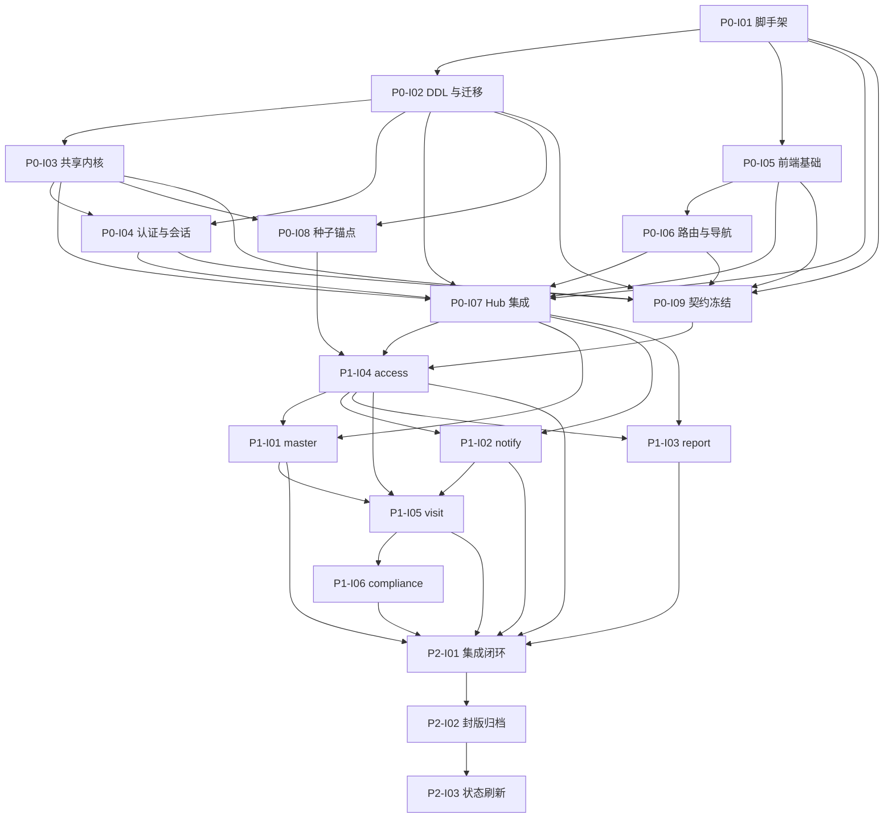

# 校园访客系统 V1.0 · Round 1 执行规划（agent_plane）

> 本文件是 `docs/trace/runs/v1/issues.yaml` 的配套总览。架构唯一真相为 `docs/trace/runs/v1/spac.md`，功能唯一真相为 `input/v1.0/PRD/14-V1.0需求文档PRD.md`，跨卡约定与逐字文案唯一真相为 `conventions.md`。
> 生成日期：2026-10-19。

---

## 一、本轮范围

| 项 | 内容 |
|----|------|
| 模式 | 首轮（从零构建） |
| 系统 | 校园访客系统 V1.0 |
| 能力域 | PT 平台门户、AP 访客预约、AT 被访人审核、GV 门卫核验放行、VS 访客门户 H5、LG 访客台账、AN 统计分析、OR 组织与权限、BD 主数据、NT 通知、SM 系统管理 |
| 限界上下文 | BC-ACCESS、BC-VISIT、BC-MASTER、BC-NOTIFY、BC-REPORT、BC-COMPLIANCE |
| 需求 | 45 条 REQ / 49 条 US |
| 测试用例 | 107 条（103 条可验证、4 条部分可达；孤儿断言 O-01…O-04） |
| 卡片 | 18 张（Phase 0：9、Phase 1：6、Phase 2：3） |
| 故事点 | 151 |
| 技术栈 | Vue 3 + Ant Design Vue 4 + Vite；Node 20 + Express 4 + TypeScript；PostgreSQL 15；docker compose |

---

## 二、输入文件与来源

| 输入 | 路径 | 在本轮的作用 |
|------|------|--------------|
| PRD | `input/v1.0/PRD/14-V1.0需求文档PRD.md` | 功能唯一真相；需求、状态机、权限、文案口径的最终依据 |
| DDD | `input/v1.0/DDD/*` | 领域对象、实体、规则候选；与 PRD 冲突时以 PRD 为准 |
| 高保真原型 | `input/v1.0/需求梳理/10-V1.0高保真原型.html` | 仅界面结构与交互结果参考；mock 数据层、角色切换器、演示横幅、切换真实接口、重置演示数据全部剔除 |
| 裁决结论 | `output/v1.0/产品裁决结论.md` | 前序裁决的输入，不作为强制约束；与 PRD 相悖处以 PRD 为准 |
| 测试规格 | `output/v1.0/测试.md` | 107 条测试用例的已定预期 |
| 测试判定 | `output/v1.0/测试结果.md` | 可验证性判定 |
| 孤儿用例 | `output/v1.0/孤儿测试用例.md` | O-01…O-04 孤儿断言的剔除依据 |

---

## 三、生产就绪差距报告

设计阶段已消解、并落到 `spac.md` §11 的决策（S-01…S-47）覆盖以下差距：

| # | 差距 | 消解方式 | 落点 |
|---|------|----------|------|
| 1 | 登录锁定语义未定：按账号还是按 IP | 按账号计数，连续 5 次失败锁定 10 分钟，自动解锁；成功后清零 | S-45、`VIS-P0-I04`、`VIS-P1-I04` |
| 2 | 改期确认超时的边界未定 | 提议时刻起 3 小时整为界；到界即 `已过期`，不可再确认 | S-47、`VIS-P1-I05` |
| 3 | 已离校当日再次进校是否二次核销 | 当天再次进校不二次核销，`visit_credentials.usage_status` 保持 `已使用`，追加 `enter` 通行记录 | S-44、`VIS-P1-I05` |
| 4 | 现场登记与黑名单的关系未定 | 现场登记豁免「未过期/已审核」，仍过黑名单，命中即硬拦并写异常 | S-43、`VIS-P1-I05` |
| 5 | 人工清除与审计明文保留的冲突 | 主记录 PII 物理置空；审计 `before/after` 明文保留；本人副本证件号掩码 | S-46、`VIS-P1-I06` |
| 6 | 唯一管理员被停用/降级 | 禁止停用或删除当前登录账号；至少保留一个启用中的管理员 | COPY-379/COPY-380、`VIS-P1-I04` |
| 7 | 导出零行 | 仍返回带表头的 CSV/XLSX，不返回 404 | S-42、`VIS-P1-I03` |
| 8 | 时段规则「删除」的语义 | 删除即失效，不物理删除历史引用 | 约定 7、`VIS-P1-I01` |
| 9 | 非 admin 完整证件号检索 | 403 + COPY-208，写越权审计 | `VIS-P1-I03` |
| 10 | 通知渠道预留 | 站内固定启用；短信/企微预留并关闭；安全类不受开关影响 | `VIS-P1-I02`、O-04 剔除 |
| 11 | 访客令牌过期后的换发渠道 | PRD 未定义，列为孤儿断言 O-01，不实现验证码换发 | O-01 剔除、`VIS-P1-I05` |
| 12 | 隐私「更正」流程 | PRD 未定义，列为孤儿断言 O-03，不提供更正端点 | O-03 剔除、`VIS-P1-I06` |
| 13 | 留存到期「隐去人像」 | 系统无肖像字段，列为孤儿断言 O-02，只做证件号掩码 | O-02 剔除、`VIS-P1-I03` |
| 14 | 短信/企微开启后按渠道发送 | 与 PRD「预留关闭」相悖，列为孤儿断言 O-04，只验证关闭态 | O-04 剔除、`VIS-P1-I02` |

---

## 四、卡片总览

| # | 卡片 | Phase | 点 | blocked_by |
|---|------|-------|----|------------|
| 1 | `VIS-P0-I01` 项目脚手架与运行时闭环卡 | 0 | 5 | — |
| 2 | `VIS-P0-I02` 数据库 DDL 与迁移执行器卡 | 0 | 8 | I01 |
| 3 | `VIS-P0-I03` 共享内核卡 | 0 | 8 | I02 |
| 4 | `VIS-P0-I04` 认证与会话中间件卡 | 0 | 5 | I02、I03 |
| 5 | `VIS-P0-I05` 前端基础卡 | 0 | 5 | I01 |
| 6 | `VIS-P0-I06` 前端路由与导航骨架卡 | 0 | 5 | I05 |
| 7 | `VIS-P0-I07` Hub 集成补全卡 | 0 | 5 | I01…I06 |
| 8 | `VIS-P0-I08` 种子锚点与执行器卡 | 0 | 5 | I02、I03 |
| 9 | `VIS-P0-I09` 契约冻结卡 | 0 | 5 | I01…I06 |
| 10 | `VIS-P1-I01` master 主数据全栈卡 | 1 | 13 | I07、I04 |
| 11 | `VIS-P1-I02` notify 通知全栈卡 | 1 | 10 | I07、I04 |
| 12 | `VIS-P1-I03` report 台账统计全栈卡 | 1 | 15 | I07、I04 |
| 13 | `VIS-P1-I04` access 门户权限全栈卡 | 1 | 13 | I07、I08、I09 |
| 14 | `VIS-P1-I05` visit 来访闭环全栈卡 | 1 | 21 | I07、I01、I02、I04 |
| 15 | `VIS-P1-I06` compliance 审计隐私全栈卡 | 1 | 10 | I05 |
| 16 | `VIS-P2-I01` 集成闭环卡 | 2 | 8 | I01…I06（Phase 1） |
| 17 | `VIS-P2-I02` 封版归档卡 | 2 | 5 | P2-I01 |
| 18 | `VIS-P2-I03` 状态刷新卡 | 2 | 5 | P2-I02 |

> `blocked_by` 中的 `I01`、`I02` 等简写在 YAML 内为完整编号。Phase 1 的 master / notify / report / visit 均依赖 `VIS-P1-I04`，原因是四张卡的验证段使用后台登录会话（`curl -b admin.txt` / `host.txt` / `guard.txt`），会话由 access 卡提供。
> `VIS-P1-I04` 另依赖 `VIS-P0-I08`（种子账号 `admin`、`guard01`、`T001`、`T002`，密码 `abc@123`）与 `VIS-P0-I09`（`contracts/` 七件套）。这两条边使全部 Phase 1 卡在种子执行与契约冻结之后才可开始。

---

## 五、依赖图

### 依赖结构复核

| 指标 | 结果 |
|------|------|
| 节点 / 边 | 18 / 42 |
| 图形态 | 有向无环图，唯一根 `VIS-P0-I01`，唯一叶 `VIS-P2-I03` |
| 拓扑层数 | 12 层（L0–L11） |
| 最大并行宽度 | 3 张卡（L6：master、notify、report，合计 38 点） |
| 关键路径 | `P0-I01 → P0-I02 → P0-I03 → P0-I04 → P0-I07 → P1-I04 → P1-I01 → P1-I05 → P1-I06 → P2-I01 → P2-I02 → P2-I03` |
| 关键路径规模 | 12 张卡 / 106 点，占 151 点的 70%；其余 45 点可并行 |
| 悬空 / 环 | 0 / 0 |

**层次与并行批次**：

| 层 | 卡片 | 点数 |
|----|------|------|
| L0 | P0-I01 | 5 |
| L1 | P0-I02、P0-I05 | 13 |
| L2 | P0-I03、P0-I06 | 13 |
| L3 | P0-I04、P0-I08 | 10 |
| L4 | P0-I07、P0-I09 | 10 |
| L5 | P1-I04 | 13 |
| L6 | P1-I01、P1-I02、P1-I03 | 38 |
| L7 | P1-I05 | 21 |
| L8 | P1-I06 | 10 |
| L9 | P2-I01 | 8 |
| L10 | P2-I02 | 5 |
| L11 | P2-I03 | 5 |

**复核结论**：

1. **已修复两条缺失边**：`P0-I08 → P1-I04` 与 `P0-I09 → P1-I04`。理由：access 卡的验证使用种子账号 `admin`、`guard01`、`T001`、`T002`，且全部 Phase 1 卡声明消费 `contracts/`；原先种子卡与契约冻结卡均为无下游的叶节点，执行顺序可能跳过二者。补边后两张卡不再是叶节点，且全部 Phase 1 卡经 `P1-I04` 传递依赖它们。
2. **保留 19 条传递冗余边**：Hub 卡与契约冻结卡对 P0 组件的全量依赖、集成闭环卡对六张 P1 卡的全量依赖属于**验收闸门**，即使可传递推导也显式保留；`P1-I04` 对 `P1-I01/I02/I03/I05` 的重复声明同理。冗余边不改变拓扑层，不影响执行顺序。
3. **串行瓶颈在 `P1-I04`**：master、notify、report 三张卡均等待 access 提供的登录会话。这是验证可达性的必要约束；若需压缩工期，只能在 access 完成后并行开始三卡，不能提前。
4. **`P0-I08` 与 `P0-I09` 可并行**：二者分别位于 L3 与 L4，不互相依赖，也不阻塞主干 `P0-I07`。

---

## 六、测试用例覆盖

| 卡片 | TC 条数 | 编号段 |
|------|---------|--------|
| `VIS-P1-I04` access | 14 | TC-PT-001…012、TC-OR-001…003 |
| `VIS-P1-I05` visit | 54 | TC-AP-001…015、TC-AT-001…007、TC-GV-001…010、TC-VS-001…005 |
| `VIS-P1-I01` master | 13 | TC-BD-001…005、TC-AP-006…008、TC-GV-007…009 |
| `VIS-P1-I02` notify | 6 | TC-NT-001…004、TC-PT-011、TC-PT-012 |
| `VIS-P1-I03` report | 16 | TC-LG-001…006、TC-AN-001…006、TC-SM-004、TC-AP-012…013 |
| `VIS-P1-I06` compliance | 4 | TC-SM-001、002、003、006 |
| **合计** | **107** | 与 `output/v1.0/测试.md` 一一对应，无重号、无遗漏 |

每张卡片的「测试用例与结果比对」表逐条列出：已定预期、本次实际运行结果（本轮只做设计，统一标注「未执行」并写明落点）、比对结论。4 条部分可达用例显式标注剔除的孤儿断言：

| TC | 孤儿断言 | 结论 |
|----|----------|------|
| TC-VS-002 | O-01 手机号+验证码重新换取令牌 | 部分可达 |
| TC-SM-005 | O-02 隐去人像 | 部分可达 |
| TC-SM-006 | O-03 本人请求更正 | 部分可达 |
| TC-NT-004 | O-04 开启短信/企微后按渠道发送 | 部分可达 |

### 需求覆盖矩阵（45 条 REQ）

每张卡「目标」段末行登记 `承载需求`；下表逐条给出主责卡、支撑卡与卡内证据。主责卡合计覆盖 PRD 全部 45 条 REQ，无遗漏、无多余。

| REQ | 需求 | 主责卡 | 支撑卡 | 卡内证据 |
|-----|------|--------|--------|----------|
| REQ-PT-001 | 统一登录与身份识别 | `VIS-P1-I04` | `VIS-P0-I04` | `/login`；连续 5 次失败锁 10 分钟；TC-PT-001…004 |
| REQ-PT-002 | 角色工作台路由 | `VIS-P1-I04` | `VIS-P0-I06` | 三角色工作台与路由守卫；TC-PT-007/008 |
| REQ-PT-003 | 我的待办聚合 | `VIS-P1-I04` | — | `workbench.service.ts` 按角色聚合；TC-PT-010 |
| REQ-PT-004 | 通知与消息入口 | `VIS-P1-I02` | `VIS-P0-I05` | 通知中心未读与已读持久；TC-PT-011/012 |
| REQ-PT-005 | 访客申请入口二维码 | `VIS-P1-I04` | `VIS-P1-I01` | `/system/entry-qr` 与 `entry_url`；TC-PT-013/014 |
| REQ-AP-001 | 提交来访预约 | `VIS-P1-I05` | — | 手机号、证件号、时段、必填全量校验；TC-AP-001…005 |
| REQ-AP-002 | 随行逐人登记 | `VIS-P1-I05` | — | 随行 ≤10 与逐人证件校验；TC-AP-006/007 |
| REQ-AP-003 | 预约信息校验 | `VIS-P1-I05` | `VIS-P1-I01` | 未完结集闭区间相交、黑名单优先、时段规则；TC-AP-008…012 |
| REQ-AP-004 | 预约修改·取消 | `VIS-P1-I05` | — | 改期重校验排除自身、已到访/已离校 409；TC-AP-013…016 |
| REQ-AP-005 | 预约状态跟踪 | `VIS-P1-I05` | — | 8 态与状态历史同源；TC-AP-017 |
| REQ-AT-001 | 待审核列表 | `VIS-P1-I05` | — | `reviewer_id=当前用户 OR admin`，被访人仅在解析为审核人时可见；TC-AT-001…003 |
| REQ-AT-002 | 审核处理 | `VIS-P1-I05` | — | 通过、拒绝、提议改期、3 小时超时；TC-AT-004…007 |
| REQ-AT-003 | 审核人可配置 | `VIS-P1-I05` | `VIS-P1-I01` | `/reviews/assignment` 经 master 门面 `upsertReviewerRules` 写入；TC-AT-008/009 |
| REQ-AT-004 | 审核留痕 | `VIS-P1-I05` | `VIS-P0-I03` | `GET /reviews/:id/logs` 与 `operation_logs`；TC-AT-010/011 |
| REQ-GV-001 | 现场核验 | `VIS-P1-I05` | — | 核验窗口 `[visit_start−15min, visit_end+15min]`；TC-GV-001/002 |
| REQ-GV-002 | 放行与现场登记 | `VIS-P1-I05` | — | `POST /gate/admit`、`POST /gate/walk-in`；TC-GV-003…005 |
| REQ-GV-003 | 访客凭证核销 | `VIS-P1-I05` | — | 短码全局唯一、首次核销、重复 409；TC-GV-006/007 |
| REQ-GV-004 | 进校·离校登记 | `VIS-P1-I05` | — | 离校、当日再次进校、时刻精确到分钟；TC-GV-008…010 |
| REQ-GV-005 | 异常上报 | `VIS-P1-I05` | `VIS-P1-I02`、`VIS-P1-I03` | 4 类异常与处置状态机；TC-GV-011/012 |
| REQ-GV-006 | 门口当日视图 | `VIS-P1-I05` | — | `GET /gate/today` 仅本地当日；TC-GV-013 |
| REQ-VS-001 | 我要申请 | `VIS-P1-I05` | — | H5 三步提交；TC-VS-001 |
| REQ-VS-002 | 我的申请查看 | `VIS-P1-I05` | — | 令牌绑定、短码不可读详情、越权 403；TC-VS-002/003/006 |
| REQ-VS-003 | 安全告知·授权告知确认 | `VIS-P1-I05` | — | 两份告知必勾选、每次留痕；TC-VS-004/005 |
| REQ-VS-004 | 扫码进入 | `VIS-P1-I05` | `VIS-P0-I05` | `/h5/apply`、320–480px 适配；TC-VS-006/007 |
| REQ-LG-001 | 访客台账 | `VIS-P1-I03` | — | 分页默认 20/上限 100、倒序、空态；TC-LG-001…003 |
| REQ-LG-002 | 在校实时清单 | `VIS-P1-I03` | — | `/on-campus` 按最后状态取数；TC-LG-004/005 |
| REQ-LG-003 | 多条件查询检索 | `VIS-P1-I03` | — | 组合筛选、脱敏检索、1 万条 <2s；TC-LG-006…008 |
| REQ-LG-004 | 导出·打印 | `VIS-P1-I03` | `VIS-P0-I03` | 11 列、F-010 掩码、CSV BOM、XLSX 头；TC-LG-009…012 |
| REQ-AN-001 | 来访量统计 | `VIS-P1-I03` | — | 到访成立集、按人次、按到访日；TC-AN-001/002 |
| REQ-AN-002 | 异常统计 | `VIS-P1-I03` | `VIS-P1-I05` | `GET /stats/incidents`；TC-AN-003 |
| REQ-OR-001 | 用户·账号管理 | `VIS-P1-I04` | — | 用户增改停启、软状态、删除 405；TC-OR-001/002 |
| REQ-OR-002 | 角色与权限 | `VIS-P1-I04` | `VIS-P0-I04` | 服务端权限闸门、403、越权审计；TC-OR-005、TC-PT-009 |
| REQ-OR-003 | 数据范围控制 | `VIS-P1-I03`、`VIS-P1-I05` | `VIS-P0-I04` | 台账角色范围、对象级隔离；TC-LG-001、TC-OR-003/004/006/007 |
| REQ-BD-001 | 访客类型管理 | `VIS-P1-I01` | `VIS-P1-I05` | 软状态停用与历史保留；TC-BD-001 |
| REQ-BD-002 | 黑名单管理 | `VIS-P1-I01` | `VIS-P1-I05`、`VIS-P1-I02` | 提交软提示、核验硬拦、通知与到期失效；TC-BD-002…004 |
| REQ-BD-003 | 时段规则管理 | `VIS-P1-I01` | `VIS-P1-I05` | 07:00–18:00、缓冲 15min、上限 240min、禁入优先；TC-BD-005…007 |
| REQ-BD-004 | 校门·通行点管理 | `VIS-P1-I01` | `VIS-P1-I05` | 校门软状态、通行记录 `gate_id`；TC-BD-008/009 |
| REQ-BD-005 | 被访人·教职工名册 | `VIS-P1-I01` | `VIS-P1-I05` | 名册软状态、下拉来源；TC-BD-010/011 |
| REQ-NT-001 | 流转通知 | `VIS-P1-I02` | `VIS-P1-I05` | 5 类流转模板与 T-30 提醒；TC-NT-001/002 |
| REQ-NT-002 | 异常提醒 | `VIS-P1-I02` | `VIS-P1-I05` | 安全通知不受渠道开关影响；TC-NT-003 |
| REQ-NT-003 | 通知渠道可配 | `VIS-P1-I02` | — | 站内固定启用、短信/企微预留关闭；TC-NT-004 |
| REQ-SM-001 | 操作日志·留痕 | `VIS-P1-I06` | `VIS-P0-I03`、`VIS-P1-I05` | 最小字段、365 天、七类动作（含提交与离校）；TC-SM-001/002 |
| REQ-SM-002 | 个人信息保护 | `VIS-P1-I06` | `VIS-P1-I05` | 90 天脱敏、物理清除、本人副本；TC-SM-005/006 |
| REQ-SM-003 | 参数配置 | `VIS-P1-I01` | `VIS-P1-I04` | `/system/params` 修改即生效；TC-SM-007 |
| REQ-SM-004 | 数据字典 | `VIS-P1-I01` | — | `/system/dictionary` 可维护；TC-SM-008 |

**已确认的范围排除（不计为未覆盖）**：

| REQ | 排除内容 | 依据 |
|-----|----------|------|
| REQ-VS-002 | 令牌过期后手机号+验证码重新换取 | PRD 内部冲突（REQ-NT-003 短信关闭）；RQ-02 已确认，ADJ-035 |
| REQ-SM-002 | 本人「更正」流程 | PRD 未定义接口与审批流；RQ-03 已确认，ADJ-032 |

### 结果存放位置

| 阶段 | 产物 | 路径 | 内容 |
|------|------|------|------|
| 单卡执行 | 本卡实测结果 | `docs/trace/runs/v1/test-results/<卡片编号>.md` | 逐条 TC 的命令、原始输出摘要、通过/失败结论；失败项附现象、根因、修复文件、回归命令 |
| 集成闭环 | 全量汇总 | `docs/trace/runs/v1/test-results/summary.md` | 107 行，逐行给出卡片、TC、结论、结果文件锚点；结论只取「通过 / 部分可达 / 未通过」 |
| 集成闭环 | 集成报告 | `docs/trace/runs/v1/integration-report.md` | 三阶段命令、原始输出摘要、失败项修复记录 |
| 封版归档 | 封版记录 | `docs/trace/runs/v1/FREEZE` | 基线 commit、日期、10 项检查、汇总表结论统计 |
| 单卡执行 | 执行记忆 | `docs/memory/2026-10-19/<卡片编号>.md` | 文件清单、验证输出、剩余风险 |

`output/v1.0/测试.md` 与 `output/v1.0/测试结果.md` 是只读输入，执行期不回写、不覆盖；执行结果只写入上述四个位置。

---

## 七、Gate 1 设计复核发现与处理

| Lens | 发现 | 处理 |
|------|------|------|
| adversarial | `req.audit` 由路由之后的中间件注入，业务 service 实际取不到 | 改为各 service 在事务内直接调用 `writeAudit`；`auditMiddleware` 只做请求级兜底透传 |
| adversarial | 根路由 `name: 'root'` 在 §7.5 只被引用、未定义 | §7.5 显式定义根记录与 `RouterContainer.vue`，同步 manifest 与 `shared-kernel-api.md` |
| edge-case-hunter | 改期超时、零行导出、同日再次进校、现场登记重复、重置密码解锁、自保护、审计明文保留 | 新增 S-41…S-47，逐条落到卡片验收标准 |
| verification-gap | `@/*` 别名未在 `vite.config.ts` 与 `tsconfig.json` 声明 | §8.5 补齐两处声明 |
| assembly-gap | 第 13、14 步缺少装配点与失败现象 | 补 `site`、`owner`、`failure` 三列；`initRealtime` 装配点移到 `main.ts` |
| assembly-gap | `shared-kernel-manifest.yaml` 只登记文件名，未登记导出名 | 全部文件补 `exports[].name`；Hub 卡写逐字挂载行 |
| 一致性 | `seed-anchors.sql` 两个 UUID 末段 13 位、通知掩码星号位数错误 | 改为 `...ee01`/`...ee02`；18 位证件号掩码改为 10 个星号 |

---

## 八、Gate 2 卡片复核发现与处理

| Lens | 发现 | 处理 |
|------|------|------|
| symbol-gap | 两张卡用 `from '../../../shared/middleware/...'` 省略号路径 | 拆为 `requireAuth` 与 `requirePermission` 两条逐字 import |
| symbol-gap | `PERMISSIONS` 卡内写成 `Record<string, string>`，manifest 为 `readonly string[]` | 统一为 `readonly string[]`（33 项） |
| symbol-gap | `runMigrations` 卡内返回 `Promise<number>`，manifest 为 `Promise<{ applied: string[] }>` | 统一为 `{ applied: string[] }` |
| 责任重叠 | 数据库卡与共享内核卡同时创建 `shared/db/pool.ts` | 归数据库卡独占；共享内核卡删除该任务；manifest `owner` 同步 |
| 依赖错误 | 认证卡声明 `jsonwebtoken` 但注明「无需 JWT」 | 删除该依赖 |
| 依赖错误 | 校验库在卡片写作 `zod`，与 `shared-kernel-api.md` 的 express-validator 不一致 | 全部改为 `express-validator` |
| adversarial | P0-I06 在共享路由中重复声明 `/login`、`/403`，与 access 卡的 `views/access/routes.ts` 冲突，且 P0 阶段页面不存在会导致构建失败 | 共享路由只留根记录与 `/h5`；`/login`、`/403` 移入 access 卡，`ForbiddenPage.vue` 归 access 卡 |
| verification-gap | P0-I04 用 `/auth/login`、`/auth/logout` 验证，但这两个端点属于 access 卡（P1） | 改为本地单测 + `tsx -e` 权限/哈希断言 + 源码断言 |
| verification-gap | P0-I07 用「登录后铃铛 +1」验证，依赖通知与页面 | 改为实时通道单测断言（未认证断开、已认证收事件） |
| verification-gap | master 卡用 `GET /appointments/form-options`、`GET /logs` 验证，这些端点属于 visit/report | 改为 master 自身端点与 `psql` 断言历史预约保留 |
| verification-gap | access 卡用 `GET /system/params` 验证 403，该端点属于 master | 改为 access 自身的 `GET /users` → 403 + 越权审计 |
| verification-gap | notify 卡用「点击消息跳预约详情」「产生新通知」验证，依赖 visit | 改为组件跳转源码断言 + 直调 `publishNotification` 的实时事件断言 |
| 依赖链 | master/notify/report/visit 的验证都需要后台登录会话，但依赖链未含 access | 四张卡的 `blocked_by` 增加 `VIS-P1-I04` |
| 文案 | 敏感操作确认框逐字文案 | 停用、删除黑名单、删除时段规则、取消预约、同意预约、人工清除、退出登录均给出 `title` + `content`，正文说明后果与可否恢复 |
| 文案 | 「操作失败」「请查看日志」类万能句 | 全文 0 命中 |
| 测试数据 | `...552`、`...662`、`...711` 等缩写 UUID，`curl ... guard01` 省略命令 | 补全为字面 UUID 与完整命令；`<token>` 改为 `$(curl ... /auth/csrf \| jq -r .data.csrf_token)` |
| 测试数据 | 「测试访客」哑值 | 改为可读姓名「林晓」 |
| 需求追溯 | `issues.yaml` 全文 0 处 REQ-ID，45 条 REQ 无法机械核对覆盖 | 18 张卡「目标」段末行登记 `承载需求`；§六新增 45 行覆盖矩阵；复核结果 45/45 |
| adversarial | REQ-AT-001 的待审核可见条件含 `host_id 绑定`，被访人在审核人另配时仍可见，宽于 PRD「仅解析出的审核人」 | 收紧为 `reviewer_id=当前用户 OR admin` |
| 责任边界 | `reviewer_rules` 归 master，但 `PUT /reviews/assignment` 在 visit 卡直写该表 | master 门面新增 `upsertReviewerRules`；visit 只经门面写入 |
| 审计遗漏 | PRD §6 埋点七类动作中的「预约提交」「离校」未在 visit 卡任务段强制写入审计 | 预约创建写 `action='新增预约'`、离校写 `action='离校'`，列入验收标准 |
| 依赖缺失 | `VIS-P0-I08` 种子卡无任何下游，但全部 Phase 1 卡的验证都登录种子账号 | `VIS-P1-I04` 增加 `blocked_by: VIS-P0-I08`，经 access 传递到全部 Phase 1 卡 |
| 依赖缺失 | `VIS-P0-I09` 契约冻结卡无任何下游，但全部 Phase 1 卡声明消费 `contracts/` | `VIS-P1-I04` 增加 `blocked_by: VIS-P0-I09` |
| 依赖复核 | 42 条边中 19 条为传递冗余 | 保留 Hub、契约冻结、集成闭环三类验收闸门边；其余冗余边不改变拓扑层，记录为可接受冗余 |

---

## 九、Step 4 校验清单

| 检查项 | 方法 | 结果 |
|--------|------|------|
| 全部设计文件落盘 | 逐一确认 `spac.md`、`README.md`、`conventions.md`、`schema-shared.sql`、`seed-anchors.sql`、`shared-kernel-manifest.yaml`、`roles.md`、`scenes.md`、`docs/knowledge/` | 通过 |
| DDD 语义可追溯 | 状态机落 §5 CHECK 与 §6 迁移；规则落 §11 与卡片任务 | 通过 |
| 卡片覆盖完整 | 11 个能力域逐域有承载卡 | 通过 |
| 需求覆盖完整 | `grep -oE 'REQ-[A-Z]{2}-[0-9]{3}' issues.yaml \| sort -u` 与 PRD 的 45 条 REQ 逐一相等；每张功能卡「目标」段末行有 `承载需求` | 通过（45/45，无缺失、无多余） |
| Phase 0 卡存在 | 9 张 | 通过 |
| 契约冻结卡存在 | `VIS-P0-I09` 产出 `contracts/` 七件套 | 通过 |
| import 路径与符号 | 逐条比对 manifest `exports[].name`；跨域门面比对 `visit/index.ts` 导出 | 通过 |
| 装配点逐字挂载 | Hub 卡含 16 步装配代码与 `main.ts` 启动序 | 通过 |
| 集成闭环 + 封版归档 + 状态刷新 | 三张卡齐备 | 通过 |
| BFS 链 | 唯一根 `VIS-P0-I01`；无悬空、无环、全部可达 | 通过 |
| 单卡验证段 | 18 张卡的「## 验证」均 ≥4 条可执行断言 | 通过 |
| 功能完整性 | 每个页面与其消费端点在同一个卡 | 通过 |
| 无伪预分配编号 | `grep -nE 'P[0-8]-I[0-9]+' spac.md` → 0 命中 | 通过 |
| 用户可见文案 | 18 张卡均有逐字文案清单；无「非空文字」类表述 | 通过 |
| 测试数据可读 | 无尖括号业务占位、无哑值、锚点 UUID 逐字完整 | 通过 |
| 测试用例覆盖 | 107 条 TC 与 `output/v1.0/测试.md` 一一对应 | 通过 |
| 术语纪律 | `issues.yaml`、`spac.md`、`conventions.md` 与本文对五类模糊措辞 0 命中 | 通过 |
| 卡片独立性 | 路径与端点映射到责任卡，与依赖闭包比对 | 通过（跨闭包文件 0、跨闭包端点 0） |
| 验证不依赖执行现场 | 检查是否引用上游执行期产物（数据库行、Cookie Jar、结果文件） | 通过（全部由本卡或闭包内脚本重新生成） |
| 写请求验证 | 逐条检查是否带 `X-CSRF-Token` | 通过 |

> 卡片「实施阶段」段承载拆解模板的阶段字段语义（研究/规划/实现/测试/审查五值之一），标题按本仓库术语纪律改写。

---

## 十、执行顺序

1. **Phase 0 串行主干**：`I01 → I02 → I03 → I04 → I07`。`I05 → I06` 与主干并行，`I08` 在 `I02/I03` 后并行，`I09` 在 `I01…I06` 后收口。
2. **Phase 1 并行**：`access` 在 `Hub + 种子 + 契约冻结` 就绪后开始；`master`、`notify`、`report` 三张卡在 `access` 就绪后并行；`visit` 在 `master + notify + access` 后开始；`compliance` 在 `visit` 后开始。
3. **Phase 2 串行**：`P2-I01` 集成闭环 → `P2-I02` 封版归档 → `P2-I03` 状态刷新。
4. 每张卡完成后写入 `docs/memory/2026-10-19/<卡片编号>.md`，记录文件清单、验证输出与剩余风险。

---

## 十一、风险与边界

| 风险 | 影响 | 处理 |
|------|------|------|
| 宿主机无 `postgres` 主机名 | 需要数据库的单测无法直连 | 统一 `docker compose` 内运行；纯规则单测不依赖数据库 |
| 4 条部分可达用例 | 孤儿断言无法验收 | 卡片显式剔除，比对结论只写「部分可达」，不写「通过」 |
| 实时通道在 P0 阶段无生产者 | 只能测通道本身 | 通道断言放在 `VIS-P0-I07`；业务触发链路由 `VIS-P2-I01` 验证 |
| 导出大数据量性能 | 未做压测 | 列为集成闭环卡的观察项，记录实测耗时 |

---

## 十二、卡片独立性检验

完整报告：`docs/trace/runs/v1/card-independence-audit.md`。

检验前提：每张卡由一个独立 agent 执行，信息只沿 `blocked_by` 边传递；下游卡可读取闭包内已完成的代码与文件，但**不继承上游的执行现场**（数据库行、Cookie Jar、测试结果文件必须由本卡重新生成）。

### 12.1 结果

| 指标 | 数值 |
|------|------|
| 卡片 / 依赖边 | 18 / 42 |
| 闭包平均规模 | 7.6 张卡 |
| 跨闭包文件引用 | 0 |
| 跨闭包端点引用 | 0（9 处测试断言已标注「跨卡验收」） |
| 逐卡发现 | 89 项（不正确 80、冗余 9） |
| 已修复 / 保留 | 82 / 7（6 处设计性冗余 + 1 处格式契约） |

### 12.2 系统性问题与处理

| 编号 | 问题 | 处理 |
|------|------|------|
| S1 | 宿主机执行 `psql $DATABASE_URL` 无法解析 compose 主机名 `db` | 全部改为 `docker compose exec -T db psql -U visitor -d visitor_system` |
| S2 | Cookie Jar 文件名在 access 卡与其余卡不一致 | `VIS-P1-I04` 新增 `scripts/login-fixtures.sh`，统一 `admin.txt` / `guard.txt` / `host.txt` |
| S3 | 种子日期与预约编号写死，跨执行日失效 | `seed-anchors.sql` 全部改为 `CURRENT_DATE` 相对表达式；编号按 D0 生成 |
| S4 | 调度器只有 `startJob`，卡内却调用 `registerJob` / `startJobs` | 统一为 `registerJob` + `startJobs` + `stopAllJobs`，`JobDefinition.cron`，补 `node-cron@3` |
| S5 | 写请求验证漏 `X-CSRF-Token`，断言命中 403 而非目标分支 | 全部写命令补 CSRF 头 |
| S6 | 审计动作词越出 `conventions.md` 约定 11 的 28 个规范值 | 改为 `审核同意`/`审核拒绝`/`核验`(失败)/`取消预约`/`异常上报`/`异常处置` |
| S7 | 测试比对表借用下游卡端点作证据 | 结论改标「跨卡验收」，执行归 `VIS-P2-I01` |
| S8 | `/socket.io` 与 `/ws` 混用 | Vite、nginx、客户端统一 `/ws` |
| S9 | `loadConfig()` / `config` 无创建卡 | `VIS-P0-I01` 新增 `backend/src/config.ts` |
| S10 | 共享内核 API 漏 `responseEnvelope` | 补入卡内 API 块与 manifest |
| S11 | 封版依赖 git，仓库未初始化 | `VIS-P0-I01` 新增 `git init` 与基线提交 |
| S12 | `bcryptjs`、`socket.io-client`、`dayjs`、`@vue/test-utils`、`exceljs`、`node-cron` 无人安装 | 在 import 它的卡内显式安装 |
| S13 | 契约与种子摘要被抄进多张卡 | 保留摘要但标注「摘自 …」，禁止复制字段级 DDL |
| S14 | 测试证据用相对路径 `/:id/status`、`/:id/read` 等，脱离前缀后不可判定 | 全部展开为完整路径 |

### 12.3 新增的可执行夹具

| 夹具 | 归属卡 | 产物 | 消费卡 |
|------|--------|------|--------|
| `scripts/login-fixtures.sh` | `VIS-P1-I04` | `admin.txt`、`guard.txt`、`host.txt` | `VIS-P1-I01`…`I06`、`VIS-P2-I01` |
| `scripts/visitor-fixture.sh` | `VIS-P1-I05` | `h5.txt`、`h5.token` | `VIS-P1-I05`、`VIS-P1-I06`、`VIS-P2-I01` |

### 12.4 保留的设计性冗余

| 冗余 | 位置 | 保留理由 |
|------|------|----------|
| 上游契约摘要 | `VIS-P1-I04`、`VIS-P1-I05`、`VIS-P1-I06` 的「上游契约」段 | 下游 agent 不需逆向阅读上游实现即可确认门面签名；冲突时以 `p1-contracts.md` 为准 |
| 种子实体摘要 | `VIS-P1-I05` 的「种子数据来源」段 | 验证命令需要 UUID 与状态分布；只列实体级信息，列值以 `seed-anchors.sql` 为准 |

判定标准：摘要只允许出现实体名、UUID、状态、数量；出现字段级 DDL 或约束定义即视为冗余缺陷。

---

## 十三、UI 完整性检验

完整报告：`docs/trace/runs/v1/ui-completeness-audit.md`。

### 13.1 范围与判据

对 18 张卡逐张执行六维检查：页面覆盖、四态、逐字文案、角色可见性、交互保护、响应式与可访问性。判据来源为 `spac.md` §4 与 §7、`conventions.md` 约定 10 / 12 / 13。

### 13.2 结果

| 指标 | 数值 |
|------|------|
| 路由覆盖 | 18 / 18 |
| 页面组件 | 20 |
| 涉及 UI 实现的卡 | 8（P0-I05、P0-I06、P1-I01…I06） |
| UI 质量闸门卡 | 1（P2-I01） |
| `issues.yaml` COPY 引用 | 273 处 |
| 系统性缺陷 | 20 项，全部修复 |
| 新增文案口径 | COPY-388…407，共 20 条 |

### 13.3 系统性问题

| 编号 | 问题 | 处理 |
|------|------|------|
| U1 | 页面文件名与 `spac.md` 目录树冲突 | 统一为目录树名称，补入 `ForbiddenPage.vue`、`ChangePasswordDialog.vue` |
| U2 | 共享四态组件存在但页面卡未使用 | P1-I01…I06 每个取数任务显式声明四态 |
| U3 | COPY-355/356/357 无卡引用 | P0-I05 任务 17 与 P1 页面统一引用 |
| U4 | 约定要求 `Modal.confirm`，卡片使用 `ConfirmDialog` | 约定改为 `ConfirmDialog`，禁止 `Modal.confirm` |
| U5 | 工作台 KPI 与角色权限不一致 | 按 §4.2.2 拆分 guard / host 可见 KPI 与落点 |
| U6 | 通知跳转指向不存在的 `/appointments/:id` | 改为 `?appointmentId=`，详情抽屉自动打开 |
| U7 | 终态预约仍显示改期/取消 | 仅 `待审核`/`已改期`/`已通过` 渲染 |
| U8 | H5 未勾选告知被前端拦截 | 前端不拦截，服务端 422 后定位告知区 |
| U9 | H5 触摸区与安全区缺失 | 44px、`env(safe-area-inset-bottom)`、后台 1024px |
| U10 | 导出缺少下载闭环 | 补 blob、文件名、对象 URL 释放、导出中禁用 |
| U11 | 打印范围未定义 | `print.css` 隐藏壳层，保留 11 列与 `.print-only` |
| U12 | 多处文案未登记 | 新增 COPY-388…396 |
| U13 | 导航标题未登记 | 新增 COPY-397…407 |
| U14 | 操作日志改动前后无呈现规则 | 并排 JSON、字母序、差异高亮、折叠、空值 `—` |
| U15 | 黑名单命中可被误放行 | 只调用 `/gate/incidents`，禁止 `/gate/admit` |
| U16 | 统计图表缺少可读性设计 | 原生 SVG、`<title>`、图例开关、零值显式 |
| U17 | 用户页出现未定义的删除入口 | 不渲染删除按钮，角色权限只读 |
| U18 | 403 与未知路径缺少落点 | 403 页 + 两条 catch-all |
| U19 | 集成阶段无 UI 闸门 | P2-I01 新增六维逐路由检查 |
| U20 | 约定编号引用错位 | 按 `conventions.md` 实际目录改正 |

### 13.4 执行要求

- 页面卡实现时先按文案表逐字落地，再跑该卡验证段。
- 禁止新增未登记文案；需要新文案时先回写 `conventions.md`。
- P2-I01 的 UI 质量闸门结果写入 `integration-report.md`，作为封版前置条件。
