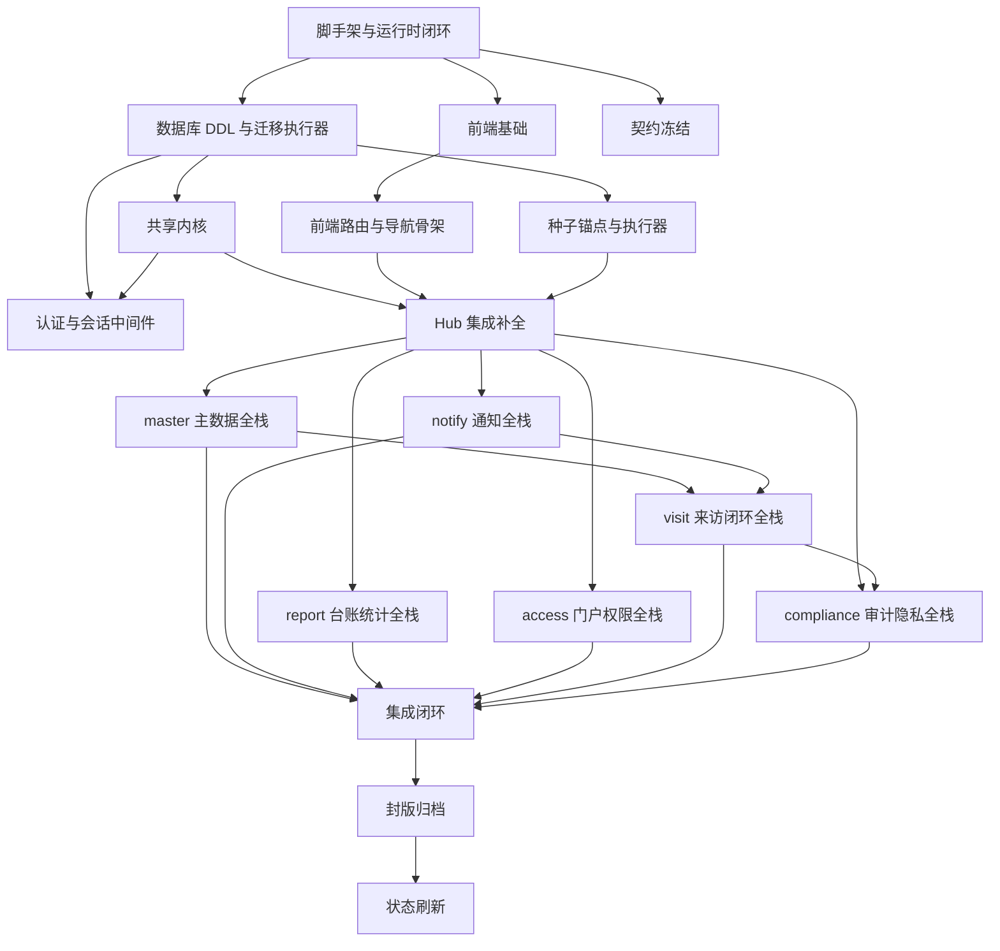

# 校园访客系统 V1.0 · 系统架构设计（spac）

> 轮次：v1（首轮完整模式）
> 项目根：本文件所在仓库根目录
> 功能唯一真相：`input/v1.0/PRD/14-V1.0需求文档PRD.md`
> 视觉与交互参考：`input/v1.0/需求梳理/10-V1.0高保真原型.html`（只取页面结构、字段、交互结果；mock 数据层、角色切换器、演示横幅、切换真实接口、重置演示数据全部剔除）
> 既有裁决：`output/v1.0/产品裁决结论.md`（ADJ-001…ADJ-040、D1…D38）
> 测试规格：`output/v1.0/测试.md`、`output/v1.0/测试结果.md`、`output/v1.0/孤儿测试用例.md`
> 本文件不含任何预分配卡片编号；卡片编号由拆解环节生成。

---

## §1 系统概述

### 1.1 建设目标

校园访客系统 V1.0 交付一条可运行的来访闭环：访客通过 H5 提交预约，被访教职工或管理员审核，门卫现场核验并登记进校/离校，后台形成访客台账、在校清单与统计，安全侧提供黑名单、异常上报、审计与个人信息保护。

V1.0 的功能边界由 PRD §7 版本功能总表确定，共 45 条 REQ、11 个能力域：

| 能力域 | 代号 | REQ 数 | 说明 |
|--------|------|--------|------|
| 平台门户 | PT | 5 | 登录、角色工作台、待办、消息、入口二维码 |
| 访客预约 | AP | 5 | 提交、随行、校验、改期/取消、状态跟踪 |
| 被访人审核 | AT | 4 | 待审核、审核处理、审核人配置、审核留痕 |
| 门卫核验放行 | GV | 6 | 现场核验、放行登记、凭证核销、进出、异常、当日视图 |
| 访客门户 H5 | VS | 4 | 我要申请、我的申请、告知确认、扫码进入 |
| 访客台账 | LG | 4 | 台账、在校清单、检索、导出/打印 |
| 统计分析 | AN | 2 | 来访量、异常统计 |
| 组织与权限 | OR | 3 | 用户账号、角色权限、数据范围 |
| 主数据 | BD | 5 | 访客类型、黑名单、时段规则、校门、教职工名册 |
| 通知 | NT | 3 | 流转通知、异常提醒、渠道配置 |
| 系统管理 | SM | 4 | 操作日志、个人信息保护、参数、字典 |

### 1.2 V1.0 明确不做

以下内容在 PRD、版本规划与裁决中已排除，架构不为其保留字段、页面、端点或占位：

| 项 | 依据 |
|----|------|
| 现场人像采集与自动识别 | `05-V1.0版本规划.md` G3 归 V1.1；ADJ-031 |
| 短信、企业微信外发 | PRD REQ-NT-003；ADJ-030 |
| 访客令牌过期后凭手机号+验证码换发 | ADJ-035；RQ-02 |
| 本人更正个人信息流程 | ADJ-032；RQ-03 |
| 黑名单临时放行/白名单 override | PRD REQ-BD-002；D4 |
| 账号、访客类型、校门、教职工硬删除 | PRD §3.21；ADJ-028 |
| 时段规则独立“关闭”开关 | ADJ-029；关闭规则=删除规则 |
| 前端角色切换器、演示数据、mock 数据层 | 原型非用户操作内容，按本轮指令剔除 |

### 1.3 限界上下文

DDD 提供 6 个限界上下文，V1.0 全部落地。11 个能力域与 6 个上下文是多对一关系：上下文决定后端模块边界，能力域决定页面分组。

| 上下文 | 模块目录 | 聚合根 | 承载能力域 |
|--------|---------|--------|-----------|
| BC-ACCESS 身份与权限 | `backend/src/modules/access` | UserAccount、AuthorizationPolicy | PT（登录/工作台/二维码）、OR |
| BC-VISIT 来访闭环 | `backend/src/modules/visit` | VisitAppointment、IncidentRegistry | AP、AT、GV、VS、PT-006 令牌边界 |
| BC-MASTER 业务策略与主数据 | `backend/src/modules/master` | MasterDataCatalog、BlacklistRegistry、SystemConfiguration | BD、SM-003/004 |
| BC-NOTIFY 通知中心 | `backend/src/modules/notify` | NotificationBox | NT、PT-004 消息入口 |
| BC-REPORT 台账与分析 | `backend/src/modules/report` | 无聚合根，只读模型 | LG、AN |
| BC-COMPLIANCE 审计与隐私 | `backend/src/modules/compliance` | AuditTrail、PrivacyCase | SM-001/002 |

### 1.4 技术栈

| 层 | 选型 | 版本与约束 |
|----|------|-----------|
| 前端 | Vue 3 Composition API + Vue Router 4 + Pinia + Ant Design Vue 4 | `app.use(Antd)` 全局注册；`reset.css` 引入；TypeScript strict |
| 后端 | Node.js 20 + Express 4 + TypeScript | ES2022 / ESNext；`tsx watch` 开发；`tsc` 构建 |
| 数据库 | PostgreSQL 15 | 迁移应用启动时自执行；种子手动执行 |
| 会话 | express-session + connect-pg-simple | 表名 `sessions`，列 `sid/sess/expire` |
| 实时 | socket.io | 仅服务端到后台角色的 `notification:new`；H5 轮询 |
| 校验 | express-validator | 每条规则必须带逐字中文 `.withMessage()` |
| 密码 | bcryptjs | 轮数 `10`；密码≥6 位，不要求大小写与符号 |
| 二维码 | `qrcode`（后端生成 PNG） | 下载文件以 `\x89PNG` 开头 |
| 导出 | `exceljs` + 手写 CSV | CSV 带 BOM；XLSX 为真实 ZIP，文件头 `PK\x03\x04` |
| 测试 | vitest + supertest；前端 vitest + @vue/test-utils | 单元与接口测试；不引入第二套测试运行器 |
| 部署 | Docker Compose | `docker compose up -d --build`；健康检查 `GET /api/v1/health` |

### 1.5 源码目录

```
visitor_system_v1.0/
├── backend/
│   ├── src/
│   │   ├── main.ts
│   │   ├── app.ts
│   │   ├── config.ts
│   │   ├── modules/
│   │   │   ├── access/
│   │   │   ├── visit/
│   │   │   ├── master/
│   │   │   ├── notify/
│   │   │   ├── report/
│   │   │   └── compliance/
│   │   ├── shared/
│   │   ├── realtime/
│   │   └── jobs/
│   ├── db/
│   │   ├── migrate.ts
│   │   ├── migrations/
│   │   └── seeds/
│   ├── package.json
│   └── tsconfig.json
├── frontend/
│   ├── src/
│   │   ├── main.ts
│   │   ├── App.vue
│   │   ├── api/
│   │   ├── components/
│   │   ├── layouts/
│   │   ├── nav/
│   │   ├── router/
│   │   ├── stores/
│   │   ├── styles/
│   │   └── views/
│   ├── package.json
│   └── vite.config.ts
├── deploy/
│   └── nginx.conf
├── docker-compose.yml
├── .env.example
├── contracts/
├── docs/
│   ├── trace/runs/v1/
│   ├── knowledge/
│   └── memory/
├── conventions.md
├── schema-shared.sql
├── seed-anchors.sql
├── shared-kernel-manifest.yaml
├── roles.md
├── scenes.md
└── README.md
```

---

## §2 能力域标签与追溯

### 2.1 标签体系

| 标签 | 含义 |
|------|------|
| `domain:pt` … `domain:sm` | 需求能力域 |
| `context:access` … `context:compliance` | 限界上下文 |
| `layer:infrastructure` | Phase 0 基础设施 |
| `layer:fullstack` | 后端模块 + 前端页面同卡 |
| `layer:integration` | 集成闭环、封版、状态刷新 |
| `kind:frontend` / `kind:backend` / `kind:db` | 交付物类型辅助标签 |
| `priority:urgent` / `priority:high` / `priority:medium` | 优先级 |

### 2.2 REQ ↔ 上下文 ↔ 页面 ↔ TC 追溯

| 能力域 | REQ | 上下文 | 页面 | TC 编号段 |
|--------|-----|--------|------|-----------|
| PT | PT-001…PT-005 | access / notify / visit | `/login`、`/workbench`、`/notifications` | TC-PT-001…TC-PT-014 |
| AP | AP-001…AP-005 | visit | `/appointments`、`/h5/apply`、`/h5/my` | TC-AP-001…TC-AP-017 |
| AT | AT-001…AT-004 | visit | `/reviews` | TC-AT-001…TC-AT-011 |
| GV | GV-001…GV-006 | visit | `/gate` | TC-GV-001…TC-GV-013 |
| VS | VS-001…VS-004 | visit / compliance | `/h5/apply`、`/h5/my`、`/h5/privacy` | TC-VS-001…TC-VS-007 |
| LG | LG-001…LG-004 | report | `/ledger`、`/on-campus` | TC-LG-001…TC-LG-012 |
| AN | AN-001…AN-002 | report | `/statistics` | TC-AN-001…TC-AN-003 |
| OR | OR-001…OR-003 | access / visit | `/users` | TC-OR-001…TC-OR-007 |
| BD | BD-001…BD-005 | master | `/master` | TC-BD-001…TC-BD-011 |
| NT | NT-001…NT-003 | notify | `/notifications` | TC-NT-001…TC-NT-004 |
| SM | SM-001…SM-004 | compliance / master / report / visit | `/system/audit`、`/system/privacy`、`/system/settings` | TC-SM-001…TC-SM-008 |

### 2.3 107 条 TC 的卡片归属

每一条 TC 只归属一张实现卡，避免重复验收与责任真空。归属判据：TC 的可观察行为由哪张卡产出的页面或端点直接承载。

| 卡片（按上下文） | TC 数量 | TC 明细 |
|------------------|---------|---------|
| access 全栈卡 | 14 | PT-001、PT-002、PT-003、PT-004、PT-005、PT-007、PT-008、PT-009、PT-010、PT-013、PT-014；OR-001、OR-002、OR-005 |
| visit 全栈卡 | 54 | PT-006；AP-001…AP-017；AT-001…AT-011；GV-001…GV-013；VS-001…VS-007；SM-004；OR-003、OR-004、OR-006、OR-007 |
| master 全栈卡 | 13 | BD-001…BD-011；SM-007、SM-008 |
| notify 全栈卡 | 6 | NT-001…NT-004；PT-011、PT-012 |
| report 全栈卡 | 16 | LG-001…LG-012；AN-001…AN-003；SM-005 |
| compliance 全栈卡 | 4 | SM-001、SM-002、SM-003、SM-006 |
| **合计** | **107** | — |

---

## §3 角色、权限与数据范围

### 3.1 角色

| 角色码 | 显示名 | 登录方式 | 后台入口 | 数据范围 |
|--------|--------|----------|----------|----------|
| `admin` | 管理员 | 账号+密码 | `/workbench` | 全校 |
| `guard` | 门卫 | 账号+密码 | `/workbench` | 本地当日、现场 |
| `host` | 被访教职工 | 工号+密码 | `/workbench` | 本人相关 |
| `visitor` | 访客 | 不可枚举令牌 | 无后台；H5 | 本人绑定预约 |

访客不进入 `users` 账号体系，不占后台会话，不分配权限点。访客令牌与后台会话是两套互斥的认证方式。

### 3.2 权限点

权限点格式 `context:resource:action`。权限点只用于后台角色；访客端由 `visitorTokenAuth` 校验令牌绑定关系。

| 权限点 | 说明 | admin | guard | host |
|--------|------|:-----:|:-----:|:----:|
| `pt:workbench:read` | 查看工作台与待办 | ✓ | ✓ | ✓ |
| `pt:qr:manage` | 生成、下载、打印入口二维码 | ✓ | — | — |
| `visit:appointment:create` | 后台代提预约 | ✓ | — | ✓ |
| `visit:appointment:read` | 查看预约列表与详情 | ✓ | — | ✓ |
| `visit:appointment:update` | 改期 | ✓ | — | ✓ |
| `visit:appointment:cancel` | 取消 | ✓ | — | ✓ |
| `visit:review:read` | 查看待审核 | ✓ | — | ✓ |
| `visit:review:decide` | 同意、拒绝 | ✓ | — | ✓ |
| `visit:review:reschedule` | 提议改期 | ✓ | — | ✓ |
| `visit:gate:today:read` | 查看门口当日视图 | ✓ | ✓ | — |
| `visit:gate:verify` | 现场核验 | ✓ | ✓ | — |
| `visit:gate:admit` | 核销并放行、再次进校 | ✓ | ✓ | — |
| `visit:gate:depart` | 离校登记 | ✓ | ✓ | — |
| `visit:gate:walkin` | 无预约现场登记 | ✓ | ✓ | — |
| `visit:gate:incident:report` | 上报异常 | ✓ | ✓ | — |
| `visit:gate:incident:dispose` | 处置异常 | ✓ | — | — |
| `report:ledger:read` | 台账、在校清单、检索 | ✓ | ✓（当日） | — |
| `report:ledger:export` | 导出、打印 | ✓ | — | — |
| `report:stats:read` | 统计分析 | ✓ | — | — |
| `access:user:manage` | 用户账号管理 | ✓ | — | — |
| `access:role:read` | 角色权限查看 | ✓ | — | — |
| `master:visitor-type:manage` | 访客类型管理 | ✓ | — | — |
| `master:blacklist:manage` | 黑名单管理 | ✓ | — | — |
| `master:time-rule:manage` | 时段规则管理 | ✓ | — | — |
| `master:gate:manage` | 校门管理 | ✓ | — | — |
| `master:host:manage` | 教职工名册管理 | ✓ | — | — |
| `master:reviewer-rule:manage` | 审核人配置 | ✓ | — | — |
| `notify:notification:read` | 站内消息 | ✓ | ✓ | ✓ |
| `notify:channel:manage` | 通知渠道配置 | ✓ | — | — |
| `system:param:manage` | 系统参数 | ✓ | — | — |
| `system:dictionary:manage` | 数据字典 | ✓ | — | — |
| `compliance:audit:read` | 操作日志 | ✓ | — | — |
| `compliance:privacy:manage` | 人工清除、留存配置 | ✓ | — | — |

`admin` 在 `role_permissions` 中拥有全部权限点。`guard`、`host` 按上表授予。`visitor` 无权限点。

### 3.3 服务端强制点

1. 每个后台路由文件在 `router.use(requireAuth)` 之后逐端点声明 `requirePermission('<code>')`。
2. `adminOnly` 端点集合与 PRD §4.1 逐字一致：`/users*`、`/roles*`、`/master/*`、`/system/*`。
3. 对象级隔离在 service 层执行，不由前端隐藏替代：
   - host 读预约详情：`appointment.host_id = currentUser.host_id` 或 `appointment.reviewer_id = currentUser.id` 或 `appointment.created_by = currentUser.id`；不满足返回 403。
   - host 读审核详情：`appointment.reviewer_id = currentUser.id` 或 `appointment.host_id = currentUser.host_id`；不满足返回 403。
   - guard 读台账：`visit_start` 落在服务端本地当日 `00:00:00–23:59:59`；越界请求返回 403。
   - visitor 读预约：`visitor_tokens.appointment_id = :id` 且令牌未失效；不满足返回 403。
4. 任何 403 由 `requirePermission` 或 `assertObjectScope` 写入一条 `action='越权拦截'` 的审计，包含 user、time、objectType、objectId、result、before、after。
5. 判定只用绑定实体 id，不用姓名、工号、手机号字符串匹配。

### 3.4 登录与锁定

- 登录字段：`username`。后台账号填账号；host 填工号。后端按 `users.username` 或 `hosts.employee_no → users.host_id` 解析。
- 连续失败 5 次锁定 10 分钟；计数按账号，不按 IP；锁定期内正确密码返回 401；到期自动解锁；登录成功清零。
- 停用账号返回 401，不建立会话，记录保留。
- 密码长度≥6，不要求大小写与符号。
- 会话 Cookie：`vs.sid`，`httpOnly=true`，`sameSite=lax`，`secure=COOKIE_SECURE`，有效期 8 小时。
- CSRF：双提交 Cookie。`GET /api/v1/auth/csrf` 下发 `vs.csrf` 可读 Cookie 并在响应体返回 `csrf_token`；所有非 GET/HEAD/OPTIONS 请求必须带 `X-CSRF-Token`，值与 Cookie 一致。`POST /api/v1/auth/login` 在无会话时豁免，登录成功后前端立即获取 CSRF Token。
- 登录限流：同一 IP 每分钟最多 20 次登录请求；超过返回 429。

### 3.5 访客令牌

- H5 提交成功后，服务端生成 32 字节随机令牌，Base64URL 编码；数据库仅存 SHA-256 十六进制摘要。
- 响应体一次性返回 `visitorToken`，同时写入 `vs.visitor` HttpOnly Cookie。
- 令牌绑定一条预约；有效期至该预约进入终态 `{已拒绝, 已过期, 已取消}`。
- 请求头 `Authorization: Bearer <token>` 或 Cookie 二选一；两者同时存在时以请求头为准。
- 以 6 位短码冒充令牌调用访客详情：返回 403，写 `action='越权拦截'` 审计，不返回预约数据。
- 不提供换发、续期、找回接口。

---

## §4 路由表与页面

### 4.1 后台与 H5 路由

所有页面组件由 `views/<context>/routes.ts` 导出，组合根通过 `import.meta.glob('@/views/*/routes.ts', { eager: true })` 自动挂载。导航集中在 `frontend/src/nav/navigation.ts`，页面内不写菜单。

- 兜底：`/:pathMatch(.*)*` 按登录态重定向（已登录 `/workbench`，未登录 `/login`）；`/h5/:pathMatch(.*)*` 重定向 `/h5/apply`。
- 深链接：`/appointments?appointmentId=<uuid>` 直接打开对应详情抽屉（通知中心的跳转目标）；其余页面忽略未知查询参数。
- 角色差异：`/notifications` 的渠道配置区仅 admin 渲染；`/ledger` 的导出菜单仅 admin 渲染，guard 的到访日期固定为当日且控件禁用；`/gate` 的异常处置仅 admin 渲染。

| 路由 | 页面 | 可见角色 | 消费端点（全部属于同一实现卡） | 承载 REQ | Phase |
|------|------|----------|-------------------------------|----------|-------|
| `/login` | 登录页 | 未登录 | `POST /auth/login`、`GET /auth/csrf` | PT-001 | P1 |
| `/workbench` | 工作台 | admin/guard/host | `GET /workbench/summary`、`GET /system/entry-qr`、`GET /system/entry-qr.png` | PT-002/003/004/005 | P1 |
| `/appointments` | 访客预约管理 | admin/host | `GET /appointments`、`POST /appointments`、`GET /appointments/:id`、`PUT /appointments/:id/reschedule`、`PUT /appointments/:id/cancel`、`GET /appointments/form-options` | AP-001…AP-005 | P1 |
| `/reviews` | 被访人审核 | admin/host | `GET /reviews`、`GET /reviews/:id`、`POST /reviews/:id/approve`、`POST /reviews/:id/reject`、`POST /reviews/:id/reschedule`、`GET /reviews/:id/logs`、`GET /reviews/assignment`、`PUT /reviews/assignment` | AT-001…AT-004 | P1 |
| `/gate` | 门卫核验放行 | admin/guard | `GET /gate/today`、`POST /gate/verify`、`POST /gate/admit`、`POST /gate/depart`、`POST /gate/walk-in`、`POST /gate/incidents`、`GET /gate/incidents`、`PUT /gate/incidents/:id/disposition`、`GET /gate/form-options` | GV-001…GV-006 | P1 |
| `/h5/apply` | 我要申请 | visitor | `GET /visitor/form-options`、`POST /visitor/appointments` | VS-001/003/004 | P1 |
| `/h5/my` | 我的申请 | visitor | `GET /visitor/appointments`、`GET /visitor/appointments/:id`、`POST /visitor/appointments/:id/confirm-reschedule`、`PUT /visitor/appointments/:id/reschedule`、`PUT /visitor/appointments/:id/cancel` | VS-002 | P1 |
| `/ledger` | 访客台账 | admin/guard | `GET /logs`、`GET /logs/export` | LG-001/003/004 | P1 |
| `/on-campus` | 在校清单 | admin/guard | `GET /logs/on-campus` | LG-002 | P1 |
| `/statistics` | 统计分析 | admin | `GET /stats/visits`、`GET /stats/incidents` | AN-001/002 | P1 |
| `/users` | 用户与角色 | admin | `GET /users`、`POST /users`、`PUT /users/:id`、`PUT /users/:id/status`、`PUT /users/:id/password`、`DELETE /users/:id`、`GET /roles`、`GET /roles/:code/permissions` | OR-001/002/003 | P1 |
| `/master` | 主数据 | admin | `GET/POST/PUT /master/visitor-types*`、`GET/POST/DELETE /master/blacklist*`、`GET/POST/DELETE /master/time-rules*`、`GET/POST/PUT /master/gates*`、`GET/POST/PUT /master/hosts*` | BD-001…BD-005 | P1 |
| `/notifications` | 通知中心 | admin/guard/host | `GET /notifications`、`GET /notifications/unread-count`、`PUT /notifications/:id/read`、`PUT /notifications/read-all`、`GET /system/notification-channels`、`PUT /system/notification-channels` | NT-001/002/003、PT-004 | P1 |
| `/system/settings` | 参数与字典 | admin | `GET /system/params`、`PUT /system/params/:key`、`GET /system/dictionary`、`POST /system/dictionary`、`PUT /system/dictionary/:id/status` | SM-003/004 | P1 |
| `/system/audit` | 操作日志 | admin | `GET /audit-logs` | SM-001 | P1 |
| `/system/privacy` | 信息保护 | admin | `GET /privacy/retention`、`PUT /privacy/retention`、`POST /privacy/appointments/:id/erase`、`GET /privacy/cases` | SM-002 | P1 |
| `/h5/privacy` | 信息副本 | visitor | `GET /visitor/privacy/copy` | SM-002 | P1 |
| `/403` | 无权访问 | 全部 | 无 | OR-002 | P1 |

### 4.2 页面区域与交互状态

每个页面必须实现四态：`loading`（骨架屏）、`error`（错误提示 + 重试按钮）、`empty`（空态占位）、`data`。前端所有写操作必须有成功 Toast；长耗时动作（导出、打印、二维码生成）必须有进行中反馈。

#### 4.2.1 登录页

- 区域：品牌区（系统名“校园访客系统”）、表单区（账号/工号、密码）、提交按钮、错误提示区。
- 字段：账号/工号（必填）、密码（必填，≥6）。
- 交互：提交时按钮进入 loading 并显示“登录中...”第 5 次失败后提示锁定；成功后按角色跳转 `/workbench`。
- 不出现角色切换器、演示账号提示、mock 标识。

#### 4.2.2 工作台

- 区域：欢迎语、KPI 卡片（待审核、待核验、异常待处理、今日预约、在校访客）、待办入口、二维码卡片、消息入口。
- 角色差异：admin 显示全部 KPI 与二维码；guard 显示待核验、在校访客、异常待处理；host 显示待审核、今日预约。
- 二维码卡片：二维码预览、入口 URL、下载 PNG、打印、复制链接。
- 二维码操作：下载文件名为 `访客入口二维码.png`；打印只输出二维码卡片；入口地址只读展示。
- KPI 卡片可点击：待审核 → `/reviews`，待核验与异常待处理 → `/gate`，今日预约 → `/appointments`，在校访客 → `/on-campus`；当前角色无权限的 KPI 不渲染。
- 消息入口：铃铛图标 + 未读徽标；点击进入 `/notifications`。

#### 4.2.3 访客预约管理

- 区域：预约表单、随行人员明细表、预约列表、状态时间线。
- 预约表单字段：访客姓名、手机号、证件号、访客类型、被访人、到访时段（起/止）、来访事由、车牌号（选填）、随行人员。
- 随行人员：逐人姓名、与主访客关系、证件号；≤10 条；行内删除。
- 列表列：预约编号、访客、被访人、到访时段、状态、操作。
- 操作：详情、改期、取消。已到访/已离校不显示改期与取消按钮；服务端仍返回 409。
- 深链接：带 `?appointmentId=<uuid>` 进入时自动打开该预约的详情抽屉。
- 状态时间线：从 `appointment_status_history` 读取，展示每次流转的状态与秒级时间。

#### 4.2.4 被访人审核

- 区域：待审核列表、审核弹窗（同意/拒绝/改期）、审核人配置、审核留痕。
- 列表列：预约编号、访客、类型、到访时段、事由、操作。
- 审核同意：二次确认。
- 审核拒绝：弹窗内拒绝原因，2–100 字。
- 提议改期：弹窗内新起止时间；提示“访客需在 3 小时内确认，逾期预约将自动过期”。
- 审核留痕：时间、审核人、决定、原因、预约；支持按预约编号筛选。

#### 4.2.5 门卫核验放行

- 区域：当日 KPI、现场核验、当日进出列表、现场登记弹窗、异常上报、异常列表与处置。
- 现场核验：凭证输入（预约编号/6 位短码/二维码扫描值）、校门选择、核验并放行、无预约现场登记、拦截放行。
- 当日列表列：访客、找谁、进校时刻、离校时刻、状态、操作（离校登记/再次进校）。
- 异常上报：类型、关联预约（选填）、说明。
- 异常处置：仅 admin 可见；处置说明必填；已处理/已忽略退出待办。
- 当日 KPI：今日预约、待核验、在校访客、异常待处理。
- 核验结果卡片：姓名、被访人、到访时段、校门、状态；黑名单命中时只提供「拦截放行」，点击写异常上报且不调用放行接口，不提供任何临时放行入口。
- V1.0 只做人工核验，页面不出现人像、自动识别、摄像头入口。

#### 4.2.6 H5 我要申请

- 顶部：系统名、步骤指示（填写信息 → 阅读告知 → 提交）。
- 字段：与预约表单一致；不显示“预计入校校门”。
- 告知：《安全告知》《个人信息授权告知》两个复选框，每次进入页面默认未勾选。
- 提交按钮吸底；未勾选时提交返回 422 并定位到告知区。
- 提交按钮含安全区留白；触控目标不小于 44×44px。
- 视口 320–480px 无横向滚动；适配 iOS Safari 15+、Android Chrome 近两年、微信内置浏览器。

#### 4.2.7 H5 我的申请

- 区域：预约状态卡、预约信息、可用通行凭证、消息列表、操作按钮。
- 凭证：二维码、6 位短码、预约编号；提示“短码仅用于现场核对，不能用于查询他人信息”。
- 消息列表：展示预约详情返回的 `messages[]` 最近 5 条，超出时提供展开。
- 页脚提供「个人信息说明」入口，进入 `/h5/privacy`。
- 操作：改期（访客发起，直接进入待审核）、确认改期（已改期状态可见）、取消。
- 状态为终态时显示“该申请已结束，如需来访请重新扫码申请”。

#### 4.2.8 台账、在校清单、统计

- 台账筛选：姓名/证件号/手机号、被访人、访客类型、状态、日期范围。
- 台账列：预约编号、姓名、访客类型、手机号、证件号（脱敏）、被访人、到访时段、进校时刻、离校时刻、状态、事由。
- 分页：默认 20，上限 100，超限静默截断；按 `visit_start` 倒序。
- 角色差异：guard 的到访日期固定为当日且控件禁用；导出菜单仅 admin 渲染。
- 导出：CSV、Excel；点击后按钮 loading，文件名 `访客台账_YYYYMMDD_HHmmss.{csv,xlsx}`；打印沿用同一 11 列与同一脱敏函数。
- 在校清单列：访客、找谁、进校时刻、已在校时长、状态；只显示最后状态为 `已到访(在校中)` 的记录。
- 统计：日/周/月切换 + 访客类型筛选；来访量柱状图；异常类型分布表；空维度显示 0。

#### 4.2.9 用户与角色

- 用户列表列：账号、工号、姓名、部门、角色、状态、操作。
- 操作：新增账号、停用、启用、重置密码。
- 不提供删除按钮；直接调用 DELETE 返回 405。
- 角色权限页：角色 × 权限点矩阵；数据范围说明；只读。

#### 4.2.10 主数据

- 五个分区：访客类型、黑名单、时段规则、校门与通行点、教职工名册。
- 访客类型、校门、教职工：新增、停用、启用；不提供删除按钮。
- 黑名单：新增、删除（软删除）、到期自动失效；删除二次确认。
- 时段规则：新增、删除；删除即失效；星期与起止时间；规则类型可预约/禁入。

#### 4.2.11 通知中心

- 消息列表列：时间、消息、关联对象、状态、操作。
- 操作：标记已读、全部标记已读、查看关联预约。
- 点击跳转：admin/host 进入 `/appointments?appointmentId=<business_id>`；guard 进入 `/gate`；异常类通知统一进入 `/gate`。
- 渠道配置：仅 admin 渲染；站内消息固定启用（不可关闭）；短信、企业微信显示“预留 · 关闭”；保存后提示。
- 未读徽标通过 WebSocket `notification:new` 即时更新；断线时页面加载与 30 秒轮询兜底。

#### 4.2.12 参数与字典、操作日志、信息保护

- 参数与字典：系统参数表逐行编辑；数据字典按类型分组；修改即生效。
- 操作日志：筛选操作人、时间范围、对象、动作；列表列时间、操作人、对象、动作、结果、前后值。
- 操作日志的前后值以并排 JSON 查看器展示，字段级差异高亮，长值可折叠。
- 信息保护：留存期限（天）、到期自动脱敏说明、人工清除（输入预约编号 + 二次确认）、本人索取入口说明、隐私案件列表。
- 人工清除只清除主记录 PII，审计 before/after 保留明文。

### 4.3 用户可见文案

逐字文案的唯一权威是 `conventions.md`「语言与文案」节。本节不重复整表，只规定页面必须覆盖的文案类别：字段标签、必填与格式提示、空态、加载中、成功反馈、进行中反馈、二次确认标题与正文、状态标签、错误提示。任何页面不得出现框架默认英文、错误码直出、“操作失败”“请查看日志”万能句。

---

## §5 数据库设计

### 5.1 通用规则

- 主键统一 `VARCHAR(36)` UUID v4 字面量。
- 枚举以中文入库并配 CHECK；软状态用 `active`/`inactive`，界面显示“在用/停用”。
- 跨上下文不建外键；跨上下文引用列为软引用 + 索引。同一上下文内允许外键。
- 时间列统一 `TIMESTAMPTZ`；业务展示按 `Asia/Shanghai`。
- 业务表统一含 `created_at TIMESTAMPTZ NOT NULL DEFAULT now()`、`updated_at TIMESTAMPTZ NOT NULL DEFAULT now()`。
- 迁移文件只放 DDL；种子只放 INSERT，手动执行。
- 迁移执行器扫描 `backend/db/migrations/*.sql`，以 `_migrations` 表去重，每文件一个事务；禁止 `docker-entrypoint-initdb.d`。

### 5.2 共享基础设施表（8 张）

完整 DDL 见 `schema-shared.sql`。

| 表 | 主要列 | 约束与索引 |
|----|--------|-----------|
| `roles` | code, name, description, is_system, created_at | PK code；CHECK code ∈ {admin,guard,host,visitor} |
| `permissions` | code, name, resource, action, description | PK code |
| `role_permissions` | role_code, permission_code | PK(role_code, permission_code)；FK 两列；索引 permission_code |
| `users` | id, username, password_hash, display_name, role_code, host_id, phone, status, failed_login_count, locked_until, last_login_at, created_at, updated_at | PK id；UNIQUE username；FK role_code→roles；host_id 软引用；CHECK status ∈ {active,inactive}；索引 role_code、host_id |
| `auth_types` | code, name, description, enabled | PK code |
| `sessions` | sid, sess, expire | PK sid；索引 expire |
| `operation_logs` | id, user_id, user_name, occurred_at, object_type, object_id, action, result, before_value, after_value, ip, note | PK id；索引 occurred_at DESC、(object_type,object_id)、user_id、action |
| `system_config` | config_key, config_value, value_type, description, updated_at | PK config_key；CHECK value_type ∈ {string,number,boolean,json} |

### 5.3 主数据上下文表

#### `hosts`

| 列 | 类型 | 约束 |
|----|------|------|
| id | VARCHAR(36) | PK |
| name | VARCHAR(50) | NOT NULL |
| employee_no | VARCHAR(30) | NOT NULL, UNIQUE |
| department | VARCHAR(100) | NOT NULL DEFAULT '' |
| phone | VARCHAR(20) | NULL |
| status | VARCHAR(10) | NOT NULL DEFAULT 'active', CHECK ∈ {active,inactive} |
| created_at / updated_at | TIMESTAMPTZ | NOT NULL DEFAULT now() |

索引：`idx_hosts_status(status)`、`idx_hosts_department(department)`。

#### `visitor_types`

| 列 | 类型 | 约束 |
|----|------|------|
| id | VARCHAR(36) | PK |
| code | VARCHAR(30) | NOT NULL, UNIQUE |
| name | VARCHAR(30) | NOT NULL |
| status | VARCHAR(10) | NOT NULL DEFAULT 'active', CHECK ∈ {active,inactive} |
| sort_order | INTEGER | NOT NULL DEFAULT 0 |
| created_at / updated_at | TIMESTAMPTZ | NOT NULL DEFAULT now() |

#### `gates`

| 列 | 类型 | 约束 |
|----|------|------|
| id | VARCHAR(36) | PK |
| code | VARCHAR(30) | NOT NULL, UNIQUE |
| name | VARCHAR(30) | NOT NULL |
| status | VARCHAR(10) | NOT NULL DEFAULT 'active', CHECK ∈ {active,inactive} |
| sort_order | INTEGER | NOT NULL DEFAULT 0 |
| created_at / updated_at | TIMESTAMPTZ | NOT NULL DEFAULT now() |

#### `blacklist_entries`

| 列 | 类型 | 约束 |
|----|------|------|
| id | VARCHAR(36) | PK |
| id_no | VARCHAR(20) | NOT NULL |
| name | VARCHAR(50) | NOT NULL DEFAULT '' |
| reason | VARCHAR(200) | NOT NULL |
| expire_at | TIMESTAMPTZ | NOT NULL |
| status | VARCHAR(10) | NOT NULL DEFAULT '有效', CHECK ∈ {有效,已过期,已删除} |
| created_at / updated_at | TIMESTAMPTZ | NOT NULL DEFAULT now() |
| deleted_at | TIMESTAMPTZ | NULL |

索引：`idx_blacklist_id_no_status(id_no,status)`、`idx_blacklist_expire(expire_at)`。有效期端点按“到期时刻已过”判失效，到期时刻当刻仍有效。

#### `time_rules`

| 列 | 类型 | 约束 |
|----|------|------|
| id | VARCHAR(36) | PK |
| weekday | SMALLINT | NOT NULL, CHECK ∈ 1…7（1=周一） |
| start_time | TIME | NOT NULL |
| end_time | TIME | NOT NULL |
| rule_type | VARCHAR(10) | NOT NULL, CHECK ∈ {可预约,禁入} |
| created_at | TIMESTAMPTZ | NOT NULL DEFAULT now() |

约束：`CHECK (start_time < end_time)`；索引 `(weekday, rule_type)`。端点相接按闭区间处理：可预约时段 `[start,end]`；禁入时段 `[start,end]`。

#### `reviewer_rules`

| 列 | 类型 | 约束 |
|----|------|------|
| id | VARCHAR(36) | PK |
| visitor_type_id | VARCHAR(36) | NULL，软引用 visitor_types |
| gate_id | VARCHAR(36) | NULL，软引用 gates |
| start_time | TIME | NULL |
| end_time | TIME | NULL |
| reviewer_kind | VARCHAR(20) | NOT NULL, CHECK ∈ {host,admin,designated} |
| reviewer_user_id | VARCHAR(36) | NULL，软引用 users |
| declaration_order | INTEGER | NOT NULL |
| status | VARCHAR(10) | NOT NULL DEFAULT 'active', CHECK ∈ {active,inactive} |
| created_at / updated_at | TIMESTAMPTZ | NOT NULL DEFAULT now() |

约束：`CHECK (start_time IS NULL OR end_time IS NULL OR start_time < end_time)`；`reviewer_kind='designated'` 时 `reviewer_user_id` 非空。索引 `(status, declaration_order)`。

#### `data_dictionary`

| 列 | 类型 | 约束 |
|----|------|------|
| id | VARCHAR(36) | PK |
| dict_type | VARCHAR(30) | NOT NULL |
| dict_key | VARCHAR(30) | NOT NULL |
| dict_label | VARCHAR(50) | NOT NULL |
| sort_order | INTEGER | NOT NULL DEFAULT 0 |
| status | VARCHAR(10) | NOT NULL DEFAULT 'active', CHECK ∈ {active,inactive} |
| created_at / updated_at | TIMESTAMPTZ | NOT NULL DEFAULT now() |

约束：`UNIQUE(dict_type, dict_key)`；索引 `(dict_type, status, sort_order)`。

### 5.4 来访上下文表

#### `appointments`

| 列 | 类型 | 约束 |
|----|------|------|
| id | VARCHAR(36) | PK |
| appoint_no | VARCHAR(30) | NOT NULL, UNIQUE |
| visitor_type_id | VARCHAR(36) | NOT NULL，软引用 visitor_types |
| visitor_name | VARCHAR(20) | NULL（人工清除后置空） |
| visitor_phone | VARCHAR(20) | NULL（人工清除后置空） |
| visitor_id_no | VARCHAR(20) | NULL（人工清除后置空） |
| host_id | VARCHAR(36) | NOT NULL，软引用 hosts |
| reviewer_id | VARCHAR(36) | NULL，软引用 users |
| expected_gate_id | VARCHAR(36) | NULL，软引用 gates；仅后台代提接口可选传入，H5 不采集 |
| visit_start | TIMESTAMPTZ | NOT NULL |
| visit_end | TIMESTAMPTZ | NOT NULL |
| reason | VARCHAR(100) | NOT NULL |
| plate_no | VARCHAR(20) | NULL |
| status | VARCHAR(20) | NOT NULL, CHECK ∈ {待审核,已通过,已拒绝,已改期,已过期,已到访(在校中),已离校,已取消} |
| people_count | INTEGER | NOT NULL DEFAULT 1, CHECK ≥1 AND ≤11 |
| black_hit | BOOLEAN | NOT NULL DEFAULT false |
| reschedule_proposed_at | TIMESTAMPTZ | NULL |
| reject_reason | VARCHAR(100) | NULL |
| cancel_reason | VARCHAR(200) | NULL |
| checkin_at | TIMESTAMPTZ | NULL（最近一次进校） |
| checkout_at | TIMESTAMPTZ | NULL（最近一次离校） |
| reminder_sent_at | TIMESTAMPTZ | NULL |
| created_by | VARCHAR(36) | NULL，软引用 users；H5 为 NULL |
| created_at / updated_at | TIMESTAMPTZ | NOT NULL DEFAULT now() |

约束：`CHECK (visit_start < visit_end)`；`CHECK (people_count = 1 + 随行数)` 由 service 保证。唯一兜底索引：`UNIQUE(visitor_id_no, visit_start, visit_end)`（允许 NULL 重复）。
索引：
- `idx_appointments_visit_start(visit_start DESC)` — 台账排序与性能
- `idx_appointments_status_start(status, visit_start)` — 状态筛选、统计
- `idx_appointments_visitor_id_no(visitor_id_no)` — 防重复与检索
- `idx_appointments_visitor_phone(visitor_phone)`
- `idx_appointments_host_id(host_id)`
- `idx_appointments_reviewer_id(reviewer_id)`
- `idx_appointments_appoint_no(appoint_no)`
- `idx_appointments_created_at(created_at)`

#### `companions`

| 列 | 类型 | 约束 |
|----|------|------|
| id | VARCHAR(36) | PK |
| appointment_id | VARCHAR(36) | NOT NULL, FK → appointments(id) ON DELETE CASCADE |
| name | VARCHAR(20) | NULL（人工清除后置空） |
| relation | VARCHAR(20) | NOT NULL |
| id_no | VARCHAR(20) | NULL（人工清除后置空） |
| sort_order | INTEGER | NOT NULL DEFAULT 0 |
| created_at | TIMESTAMPTZ | NOT NULL DEFAULT now() |

索引：`idx_companions_appointment(appointment_id, sort_order)`。

#### `visit_credentials`

| 列 | 类型 | 约束 |
|----|------|------|
| id | VARCHAR(36) | PK |
| appointment_id | VARCHAR(36) | NOT NULL, UNIQUE, FK → appointments(id) ON DELETE CASCADE |
| short_code | CHAR(6) | NOT NULL, UNIQUE, CHECK `short_code ~ '^[0-9]{6}$'` |
| usage_status | VARCHAR(10) | NOT NULL DEFAULT '未使用', CHECK ∈ {未使用,已使用} |
| used_at | TIMESTAMPTZ | NULL |
| created_at | TIMESTAMPTZ | NOT NULL DEFAULT now() |

#### `passage_records`

| 列 | 类型 | 约束 |
|----|------|------|
| id | VARCHAR(36) | PK |
| appointment_id | VARCHAR(36) | NOT NULL, FK → appointments(id) ON DELETE CASCADE |
| gate_id | VARCHAR(36) | NOT NULL，软引用 gates |
| record_type | VARCHAR(10) | NOT NULL, CHECK ∈ {进校,离校} |
| occurred_at | TIMESTAMPTZ | NOT NULL |
| operator_id | VARCHAR(36) | NOT NULL，软引用 users |
| created_at | TIMESTAMPTZ | NOT NULL DEFAULT now() |

索引：`idx_passage_appointment(appointment_id, occurred_at DESC)`、`idx_passage_gate_time(gate_id, occurred_at DESC)`。

#### `consent_records`

| 列 | 类型 | 约束 |
|----|------|------|
| id | VARCHAR(36) | PK |
| appointment_id | VARCHAR(36) | NOT NULL, FK → appointments(id) ON DELETE CASCADE |
| consent_type | VARCHAR(30) | NOT NULL, CHECK ∈ {安全告知,个人信息授权告知} |
| confirmed_at | TIMESTAMPTZ | NOT NULL |
| channel | VARCHAR(20) | NOT NULL, CHECK ∈ {H5,现场登记,后台代提} |
| created_at | TIMESTAMPTZ | NOT NULL DEFAULT now() |

约束：同一 `appointment_id` 同一 `consent_type` 在 H5/现场登记渠道下唯一；`UNIQUE(appointment_id, consent_type, channel)`。索引 `idx_consent_appointment(appointment_id)`。

#### `incidents`

| 列 | 类型 | 约束 |
|----|------|------|
| id | VARCHAR(36) | PK |
| appointment_id | VARCHAR(36) | NULL, FK → appointments(id) ON DELETE SET NULL |
| incident_type | VARCHAR(20) | NOT NULL, CHECK ∈ {黑名单命中,信息不符,强行闯入,超时未离} |
| status | VARCHAR(10) | NOT NULL DEFAULT '待处理', CHECK ∈ {待处理,已处理,已忽略} |
| description | VARCHAR(500) | NOT NULL DEFAULT '' |
| reported_by | VARCHAR(36) | NOT NULL，软引用 users |
| handled_by | VARCHAR(36) | NULL，软引用 users |
| disposition_note | VARCHAR(200) | NULL |
| handled_at | TIMESTAMPTZ | NULL |
| created_at / updated_at | TIMESTAMPTZ | NOT NULL DEFAULT now() |

索引：`idx_incidents_status_created(status, created_at DESC)`、`idx_incidents_type(incident_type)`、`idx_incidents_appointment(appointment_id)`。

#### `appointment_status_history`

| 列 | 类型 | 约束 |
|----|------|------|
| id | VARCHAR(36) | PK |
| appointment_id | VARCHAR(36) | NOT NULL, FK → appointments(id) ON DELETE CASCADE |
| from_status | VARCHAR(20) | NULL |
| to_status | VARCHAR(20) | NOT NULL |
| changed_by | VARCHAR(36) | NULL，软引用 users |
| change_reason | VARCHAR(200) | NOT NULL DEFAULT '' |
| occurred_at | TIMESTAMPTZ | NOT NULL DEFAULT now() |

索引：`idx_status_history_appointment(appointment_id, occurred_at)`。

#### `visitor_tokens`

| 列 | 类型 | 约束 |
|----|------|------|
| id | VARCHAR(36) | PK |
| appointment_id | VARCHAR(36) | NOT NULL, FK → appointments(id) ON DELETE CASCADE |
| token_hash | CHAR(64) | NOT NULL, UNIQUE |
| expires_at | TIMESTAMPTZ | NULL（预约进入终态时写入） |
| created_at | TIMESTAMPTZ | NOT NULL DEFAULT now() |

索引：`idx_visitor_tokens_appointment(appointment_id)`。

### 5.5 通知上下文表

#### `notifications`

| 列 | 类型 | 约束 |
|----|------|------|
| id | VARCHAR(36) | PK |
| recipient_type | VARCHAR(10) | NOT NULL, CHECK ∈ {user,visitor} |
| recipient_id | VARCHAR(36) | NULL（user 时为 users.id；visitor 时为 appointments.id） |
| recipient_name | VARCHAR(50) | NOT NULL DEFAULT '' |
| recipient_phone | VARCHAR(20) | NULL |
| template_type | VARCHAR(30) | NOT NULL, CHECK ∈ {提交通知,审核结果,改期提议,改期确认结果,到访提醒,黑名单命中,超时未离} |
| title | VARCHAR(100) | NOT NULL |
| content | VARCHAR(500) | NOT NULL |
| business_type | VARCHAR(30) | NOT NULL |
| business_id | VARCHAR(36) | NULL |
| is_security | BOOLEAN | NOT NULL DEFAULT false |
| read_at | TIMESTAMPTZ | NULL |
| created_at | TIMESTAMPTZ | NOT NULL DEFAULT now() |

索引：`idx_notifications_recipient(recipient_type, recipient_id, read_at, created_at DESC)`、`idx_notifications_business(business_type, business_id)`。

#### `notification_channels`

| 列 | 类型 | 约束 |
|----|------|------|
| channel_code | VARCHAR(20) | PK, CHECK ∈ {站内,短信,企微} |
| enabled | BOOLEAN | NOT NULL |
| updated_at | TIMESTAMPTZ | NOT NULL DEFAULT now() |
| updated_by | VARCHAR(36) | NULL，软引用 users |

站内行 `enabled=true` 不可改为 false；短信、企微初始 `enabled=false`。

### 5.6 合规上下文表

#### `privacy_cases`

| 列 | 类型 | 约束 |
|----|------|------|
| id | VARCHAR(36) | PK |
| appointment_id | VARCHAR(36) | NULL，软引用 appointments |
| case_type | VARCHAR(20) | NOT NULL, CHECK ∈ {信息副本,人工清除} |
| requested_by | VARCHAR(36) | NULL，软引用 users；访客副本为 NULL |
| status | VARCHAR(20) | NOT NULL, CHECK ∈ {已完成,失败} |
| note | VARCHAR(200) | NOT NULL DEFAULT '' |
| created_at / completed_at | TIMESTAMPTZ | NOT NULL DEFAULT now() |

索引：`idx_privacy_cases_created(created_at DESC)`。

### 5.7 系统参数初始值

| key | 初值 | 类型 | 消费点 |
|-----|------|------|--------|
| `entry_url` | `http://localhost/h5/apply` | string | 入口二维码 |
| `privacy_retention_days` | `90` | number | 展示层脱敏、信息保护页 |
| `audit_retention_days` | `365` | number | 操作日志页 |
| `verification_buffer_minutes` | `15` | number | 门卫核验窗口 |
| `max_stay_minutes` | `240` | number | 预约时段、现场登记 |
| `min_stay_minutes` | `15` | number | 预约时段 |
| `reschedule_confirm_timeout_hours` | `3` | number | 改期确认超时 |
| `arrival_reminder_minutes` | `30` | number | 到访提醒 |
| `login_max_failures` | `5` | number | 登录锁定 |
| `login_lock_minutes` | `10` | number | 登录锁定 |
| `password_min_length` | `6` | number | 密码设置 |
| `max_companions` | `10` | number | 随行人数 |
| `ledger_page_size_default` | `20` | number | 分页 |
| `ledger_page_size_max` | `100` | number | 分页 |
| `booking_default_start` | `07:00` | string | 时段规则缺省 |
| `booking_default_end` | `18:00` | string | 时段规则缺省 |

### 5.8 种子与迁移

- `seed-anchors.sql` 提供跨域锚点：4 个后台账号、2 个 host 名册与账号、3 个访客类型、2 个校门、1 条黑名单、7 条默认可预约规则、2 类字典、11 条预约及 8 态覆盖、11 个凭证、22 条告知记录、3 条通行记录、3 条异常（1 条待处理、1 条已处理、1 条已忽略）、1 条 200 天前审计。
- 各领域卡产出的 `backend/db/seeds/NN-*.sql` 只补充本领域运行期夹具；跨域共用值逐字取自 `seed-anchors.sql`。
- 种子执行：`npm run seed`（`tsx db/seed.ts`）；迁移执行：应用启动自动调用 `runMigrations()`，另有 `npm run migrate` 手动入口。

---

## §6 API 契约

### 6.1 统一约定

- Base URL：`/api/v1`。
- JSON 键：请求与响应一律 snake_case；前端 `apiClient` 在边界做 camelCase ↔ snake_case 转换，页面内使用 camelCase。
- 响应信封：`{ code: number, message: string, data: any, field?: string }`；`code=0` 成功。
- 分页响应：`data: { items: any[], total: number, page: number, page_size: number }`。
- 分页参数：`page` 默认 1；`page_size` 默认 20，上限 100，超限静默截断。
- 空列表：HTTP 200，`{items: [], total: 0}`，不返回 404。
- 错误码：401 未认证/停用/锁定；403 越权；404 不存在；405 软状态资源硬删除；409 状态冲突；422 字段校验；429 限流。
- 校验失败响应必须带 `field`；`field` 取 snake_case 资源字段名；`message` 逐字取自 `conventions.md` 文案表。
- 时间输入输出：ISO 8601；展示由前端格式化。
- 二进制端点：`GET /system/entry-qr.png`、`GET /logs/export` 直接返回文件流，不套信封；失败时返回 JSON 信封。
- 审计：所有敏感写操作由 service 调用 `writeAudit()`；403 由中间件写“越权拦截”。

### 6.2 access 模块端点

| 方法 | 路径 | 权限 | 请求 | 成功响应 | 主要错误 | REQ/TC |
|------|------|------|------|----------|----------|--------|
| GET | `/auth/csrf` | 公开 | — | `{csrf_token}` + Set-Cookie `vs.csrf` | — | PT-001 |
| POST | `/auth/login` | 公开 | `{username,password}` | `{user:{id,username,display_name,role_code,host_id}}` + Set-Cookie `vs.sid` | 401 账号或密码错误/停用/锁定；422 字段缺失；429 限流 | PT-001/002/003/005 |
| POST | `/auth/logout` | 已登录 | — | `{logged_out:true}` | 401 | PT-001 |
| GET | `/auth/me` | 已登录 | — | `{user}` | 401 | PT-008 |
| PUT | `/auth/password` | 已登录 | `{old_password,new_password}` | `{changed:true}` | 401 原密码错误；422 新密码长度不足 | PT-004 |
| GET | `/users` | admin | query `page,page_size,keyword,role,status` | 分页用户列表 | 403 | OR-001 |
| POST | `/users` | admin | `{username,password,display_name,role_code,host_id?,department?,phone?}` | 新用户 | 409 账号/工号已存在；422 | OR-001 |
| PUT | `/users/:id` | admin | `{display_name,department?,phone?}` | 更新后的用户 | 404 | OR-001 |
| PUT | `/users/:id/status` | admin | `{status:'active'|'inactive'}` | `{id,status}` | 404；403 | OR-001/002 |
| PUT | `/users/:id/password` | admin | `{password}` | `{reset:true}` | 422 密码长度不足 | PT-004 |
| DELETE | `/users/:id` | admin | — | — | 405 | OR-001 |
| GET | `/roles` | admin | — | 角色列表 | 403 | OR-002/005 |
| GET | `/roles/:code/permissions` | admin | — | `{role,permissions[]}` | 404 | OR-002/005 |
| GET | `/workbench/summary` | 后台角色 | — | `{role,todo:{pending_review,pending_verify,pending_incident},kpi:{today_appointments,on_campus},unread_count}` | 401 | PT-003/004/010 |
| GET | `/system/entry-qr` | admin | — | `{entry_url,qr_data_url}` | 403 | PT-013/014 |
| GET | `/system/entry-qr.png` | admin | — | PNG 二进制 | 403 | PT-013/014 |

### 6.3 visit 模块端点

#### 预约后台

| 方法 | 路径 | 权限 | 请求 | 成功响应 | 主要错误 | REQ/TC |
|------|------|------|------|----------|----------|--------|
| GET | `/appointments/form-options` | admin/host | — | `{visitor_types[],hosts[],gates[],relations[]}` | 401 | AP-001 |
| GET | `/appointments` | admin/host | `page,page_size,status,keyword,date_from,date_to` | 分页预约列表 | 403 | AP-005/017 |
| POST | `/appointments` | admin/host | 预约字段 + `companions[]` + 可选 `expected_gate_id` | 新预约（含 `appoint_no`,`short_code`,`black_hit`,`warning?`） | 422 字段/时段/重复/禁入；黑名单软提示不拦截（返回 200 + warning） | AP-001…AP-013；AT-008/009 |
| GET | `/appointments/:id` | admin/host | — | 预约详情 + `history[]` + `companions[]` | 403 越权；404 | AP-017；OR-003/006 |
| PUT | `/appointments/:id/reschedule` | admin/host | `{visit_start,visit_end}` | 更新后的预约 | 403；404；409 已到访/已离校；422 | AP-013/014 |
| PUT | `/appointments/:id/cancel` | admin/host | `{reason?}` | `{status:'已取消'}` | 403；404；409 已到访/已离校/终态 | AP-015/016 |

#### 审核

| 方法 | 路径 | 权限 | 请求 | 成功响应 | 主要错误 | REQ/TC |
|------|------|------|------|----------|----------|--------|
| GET | `/reviews` | admin/host | `page,page_size,status` | 分页待审核 | 403 | AT-001/002 |
| GET | `/reviews/:id` | admin/host | — | 预约详情 | 403 越权；404 | AT-003 |
| POST | `/reviews/:id/approve` | admin/host | — | `{status:'已通过'}` | 403；409 非待审核；404 | AT-004/007 |
| POST | `/reviews/:id/reject` | admin/host | `{reason}` | `{status:'已拒绝'}` | 422 原因长度；403；409 | AT-005/007 |
| POST | `/reviews/:id/reschedule` | admin/host | `{visit_start,visit_end}` | `{status:'已改期'}` | 422 无时段/校验失败；409 已改期直接同意 | AT-006 |
| GET | `/reviews/:id/logs` | admin/host | — | `{items:[{time,operator,decision,reason}]}` | 403 | AT-010/011 |
| GET | `/reviews/assignment` | admin | — | 审核人规则列表 | 403 | AT-009 |
| PUT | `/reviews/assignment` | admin | `{rules[]}` | 保存后的规则 | 422 | AT-009 |

#### 门卫

| 方法 | 路径 | 权限 | 请求 | 成功响应 | 主要错误 | REQ/TC |
|------|------|------|------|----------|----------|--------|
| GET | `/gate/today` | admin/guard | — | `{kpi,appointments[]}`，仅本地当日 | 403 | GV-006/013 |
| GET | `/gate/form-options` | admin/guard | — | `{gates[],incident_types[],relations[]}` | 403 | GV-002/004 |
| POST | `/gate/verify` | admin/guard | `{key,gate_id,conclusion?}` | `{allowed,reason,appointment?}` | 422 字段；404 未找到；黑名单命中 allowed=false | GV-001/002/006 |
| POST | `/gate/admit` | admin/guard | `{appointment_id,gate_id}` | `{status:'已到访(在校中)',checkin_at}` | 409 重复核销/已在校；422 时段外；403 | GV-003/007/008 |
| POST | `/gate/depart` | admin/guard | `{appointment_id,gate_id}` | `{status:'已离校',checkout_at}` | 409 未在校；404 | GV-008/010 |
| POST | `/gate/walk-in` | admin/guard | 预约字段 + `{gate_id,consents:{safety:true,privacy:true}}` | `{status:'已到访(在校中)',appoint_no,short_code}` | 422 字段/告知；黑名单硬拦 | GV-004/005 |
| POST | `/gate/incidents` | admin/guard | `{incident_type,appointment_id?,description}` | 新异常 | 422；403 | GV-011 |
| GET | `/gate/incidents` | admin/guard | `page,page_size,status,type` | 分页异常 | 403 | GV-012 |
| PUT | `/gate/incidents/:id/disposition` | admin | `{status:'已处理'|'已忽略',note}` | 更新后的异常 | 403 非 admin；422 说明为空；404 | GV-012 |

#### 访客 H5

| 方法 | 路径 | 认证 | 请求 | 成功响应 | 主要错误 | REQ/TC |
|------|------|------|------|----------|----------|--------|
| GET | `/visitor/form-options` | 公开 | — | `{visitor_types[],hosts[],relations[]}` | — | VS-001 |
| POST | `/visitor/appointments` | 公开 | 预约字段 + `{consents:{safety:true,privacy:true}}` | 新预约 + `visitor_token` + Set-Cookie `vs.visitor` | 422 字段/告知/时段/重复；黑名单软提示不拦截 | VS-001/003/005 |
| GET | `/visitor/appointments` | 令牌 | — | `{items:[本人绑定预约]}` | 401/403 令牌无效或过期 | VS-002 |
| GET | `/visitor/appointments/:id` | 令牌 | — | 预约详情 + 凭证 + 消息 | 403 非本人/短码冒充；404 | VS-002/003；PT-006 |
| POST | `/visitor/appointments/:id/confirm-reschedule` | 令牌 | — | `{status:'待审核'}` | 403；409 非已改期；409 已超时并转为已过期 | AT-006 |
| PUT | `/visitor/appointments/:id/reschedule` | 令牌 | `{visit_start,visit_end}` | `{status:'待审核'}` | 403；409 已到访/已离校；422 | AP-013/014 |
| PUT | `/visitor/appointments/:id/cancel` | 令牌 | `{reason?}` | `{status:'已取消'}` | 403；409 已到访/已离校 | AP-015/016 |

### 6.4 master 模块端点

| 方法 | 路径 | 权限 | 请求 | 成功响应 | 主要错误 | REQ/TC |
|------|------|------|------|----------|----------|--------|
| GET | `/master/visitor-types` | admin | `status?,includeInactive?` | 列表 | 403 | BD-001 |
| POST | `/master/visitor-types` | admin | `{name}` | 新类型 | 409 名称重复；422 | BD-001 |
| PUT | `/master/visitor-types/:id` | admin | `{name}` | 更新 | 404 | BD-001 |
| PUT | `/master/visitor-types/:id/status` | admin | `{status}` | 更新 | 404 | BD-001 |
| DELETE | `/master/visitor-types/:id` | admin | — | — | 405 | BD-001；ADJ-028 |
| GET | `/master/blacklist` | admin | `page,page_size,keyword,status` | 分页 | 403 | BD-002 |
| POST | `/master/blacklist` | admin | `{id_no,name,reason,expire_at}` | 新条目 | 422；409 已有有效条目 | BD-002/003 |
| DELETE | `/master/blacklist/:id` | admin | — | `{status:'已删除'}` | 404 | BD-004 |
| GET | `/master/time-rules` | admin | — | 列表 | 403 | BD-003/005 |
| POST | `/master/time-rules` | admin | `{weekday,start_time,end_time,rule_type}` | 新规则 | 422 | BD-003/006 |
| DELETE | `/master/time-rules/:id` | admin | — | `{deleted:true}` | 404 | BD-003/006 |
| GET | `/master/gates` | admin | `status?,includeInactive?` | 列表 | 403 | BD-004/008 |
| POST | `/master/gates` | admin | `{name}` | 新校门 | 409；422 | BD-004 |
| PUT | `/master/gates/:id` | admin | `{name}` | 更新 | 404 | BD-004 |
| PUT | `/master/gates/:id/status` | admin | `{status}` | 更新 | 404 | BD-004 |
| DELETE | `/master/gates/:id` | admin | — | — | 405 | BD-009 |
| GET | `/master/hosts` | admin | `status?,includeInactive?` | 列表 | 403 | BD-005/010 |
| POST | `/master/hosts` | admin | `{name,employee_no,department,phone?}` | 新教职工 | 409 工号重复；422 | BD-005 |
| PUT | `/master/hosts/:id` | admin | `{name,department,phone?}` | 更新 | 404 | BD-005 |
| PUT | `/master/hosts/:id/status` | admin | `{status}` | 更新 | 404 | BD-005 |
| DELETE | `/master/hosts/:id` | admin | — | — | 405 | BD-011 |
| GET | `/system/params` | admin | — | `[{key,value,type,description}]` | 403 | SM-007 |
| PUT | `/system/params/:key` | admin | `{value}` | 更新 | 404；422 | SM-007 |
| GET | `/system/dictionary` | admin | `type?` | 列表 | 403 | SM-008 |
| POST | `/system/dictionary` | admin | `{dict_type,dict_key,dict_label,sort_order?}` | 新字典项 | 409；422 | SM-008 |
| PUT | `/system/dictionary/:id/status` | admin | `{status}` | 更新 | 404 | SM-008 |

### 6.5 notify 模块端点

| 方法 | 路径 | 权限 | 请求 | 成功响应 | 主要错误 | REQ/TC |
|------|------|------|------|----------|----------|--------|
| GET | `/notifications` | 后台角色 | `page,page_size,unread_only` | 分页消息 | 401 | NT-001/002；PT-011 |
| GET | `/notifications/unread-count` | 后台角色 | — | `{unread_count}` | 401 | PT-004/011 |
| PUT | `/notifications/:id/read` | 后台角色 | — | `{id,read_at}` | 403 非本人；404 | PT-011/012 |
| PUT | `/notifications/read-all` | 后台角色 | — | `{updated:number}` | 401 | PT-011 |
| GET | `/system/notification-channels` | admin | — | `[{channel_code,enabled}]` | 403 | NT-003/004 |
| PUT | `/system/notification-channels` | admin | `{sms:boolean,wecom:boolean}` | 更新 | 422 试图关闭站内 | NT-003/004 |

### 6.6 report 模块端点

| 方法 | 路径 | 权限 | 请求 | 成功响应 | 主要错误 | REQ/TC |
|------|------|------|------|----------|----------|--------|
| GET | `/logs` | admin/guard | `page,page_size,name,id_no,phone,host,type,status,date_from,date_to` | 分页台账 | 403 非 admin 完整证件号；403 guard 越日 | LG-001…LG-008 |
| GET | `/logs/on-campus` | admin/guard | — | `{items[]}` | 403 | LG-004/005 |
| GET | `/logs/export` | admin | `format=csv|xlsx` + 同筛选 | 文件流 | 403；422 format | LG-009/010/011 |
| GET | `/stats/visits` | admin | `granularity=day|week|month,type?,date_from,date_to` | `{buckets:[{period,type,count}]}` | 403；422 | AN-001/002 |
| GET | `/stats/incidents` | admin | `date_from,date_to` | `{types:[{type,count}],timeout_count}` | 403 | AN-003 |

### 6.7 compliance 模块端点

| 方法 | 路径 | 权限 | 请求 | 成功响应 | 主要错误 | REQ/TC |
|------|------|------|------|----------|----------|--------|
| GET | `/audit-logs` | admin | `page,page_size,user_id,action,object_type,object_id,date_from,date_to` | 分页日志 | 403 | SM-001/002/003 |
| GET | `/privacy/retention` | admin | — | `{retention_days,audit_retention_days}` | 403 | SM-002 |
| PUT | `/privacy/retention` | admin | `{retention_days}` | 更新 | 422 非正整数 | SM-002/007 |
| POST | `/privacy/appointments/:id/erase` | admin | `{reason}` | `{erased:true}` | 404；422 | SM-006 |
| GET | `/privacy/cases` | admin | `page,page_size` | 分页案件 | 403 | SM-006 |
| GET | `/visitor/privacy/copy` | 令牌 | — | `{appointment,companions,consents,passages}`，证件号掩码 | 403 非本人 | SM-006 |

### 6.8 WebSocket

- 命名空间：`/ws`。
- 握手：携带后台会话 Cookie；未认证断开。
- 房间：`user:<user_id>`。
- 事件：`notification:new`，载荷 `{id,title,templateType,createdAt}`。
- 消费者：`AppLayout` 的铃铛徽标与通知中心列表。
- H5 不建立 WebSocket，按页面加载与 30 秒轮询刷新。

### 6.9 内部门面契约

跨上下文只允许 import 目标上下文 `index.ts` 的命名导出。

#### master `index.ts`

```ts
export type VisitorTypeDto = { id: string; name: string; status: 'active' | 'inactive' };
export type HostDto = { id: string; name: string; employeeNo: string; department: string; status: 'active' | 'inactive' };
export type GateDto = { id: string; name: string; status: 'active' | 'inactive' };
export type DictionaryItemDto = { id: string; dictType: string; dictKey: string; dictLabel: string };
export type ReviewerRuleDto = { id: string; visitorTypeId: string | null; gateId: string | null; startTime: string | null; endTime: string | null; reviewerKind: 'host' | 'admin' | 'designated'; reviewerUserId: string | null; declarationOrder: number; status: 'active' | 'inactive' };

export async function getActiveVisitorTypes(): Promise<VisitorTypeDto[]>;
export async function getActiveHosts(): Promise<HostDto[]>;
export async function getActiveGates(): Promise<GateDto[]>;
export async function getDictionaryItems(dictType: string): Promise<DictionaryItemDto[]>;
export async function getConfig(key: string): Promise<string>;
export async function getConfigNumber(key: string): Promise<number>;
export async function resolveReviewer(input: {
  visitorTypeId: string;
  expectedGateId: string | null;
  visitStart: string;
  hostId: string;
}): Promise<string | null>;
export async function upsertReviewerRules(rules: Omit<ReviewerRuleDto, 'id'>[]): Promise<ReviewerRuleDto[]>;
export async function checkBlacklist(idNos: string[]): Promise<{ hit: boolean; matchedIdNos: string[] }>;
export async function expireBlacklistEntries(now: Date): Promise<number>;
```

#### visit `index.ts`

```ts
export type AppointmentSummaryDto = {
  id: string;
  appointNo: string;
  visitorName: string | null;
  status: string;
  visitStart: string;
  visitEnd: string;
  hostId: string;
  reviewerId: string | null;
};
export async function getAppointmentForCompliance(id: string): Promise<AppointmentSummaryDto | null>;
export async function eraseAppointmentPii(id: string, actorId: string, reason: string): Promise<boolean>;
export async function expireAppointments(now: Date): Promise<number>;
export async function confirmRescheduleTimeout(now: Date): Promise<number>;
```

#### notify `index.ts`

```ts
export type PublishNotificationInput = {
  recipientType: 'user' | 'visitor';
  recipientId: string;
  recipientName: string;
  recipientPhone?: string | null;
  templateType: '提交通知' | '审核结果' | '改期提议' | '改期确认结果' | '到访提醒' | '黑名单命中' | '超时未离';
  title: string;
  content: string;
  businessType: string;
  businessId: string | null;
  isSecurity: boolean;
};
export async function publishNotification(input: PublishNotificationInput): Promise<{ id: string }>;
export async function publishSecurityNotification(input: PublishNotificationInput): Promise<{ id: string }>;
```

#### access `index.ts`

```ts
export type CurrentUser = { id: string; username: string; displayName: string; roleCode: 'admin' | 'guard' | 'host'; hostId: string | null };
export async function getUserById(id: string): Promise<CurrentUser | null>;
export async function getUserByHostId(hostId: string): Promise<CurrentUser | null>;
export async function getFirstAdminUser(): Promise<CurrentUser | null>;
```

#### report / compliance

report 与 compliance 不向其他上下文提供门面导出。report 只读 SQL；compliance 只在自身页面与端点内使用。

---

## §7 模块与目录设计

### 7.1 后端模块结构

```
backend/src/modules/<context>/
├── index.ts                    # 唯一门面；只导出类型与函数
├── api/
│   ├── <resource>.routes.ts    # export default router；requireAuth + requirePermission
│   └── ...
├── internal/
│   ├── <resource>.service.ts   # 业务规则、事务、状态机
│   ├── <resource>.repo.ts      # SQL 数据访问
│   └── domain/
│       ├── entities.ts         # 实体类型
│       └── rules.ts            # 纯函数规则
└── __tests__/
    ├── <resource>.service.test.ts
    └── <resource>.rules.test.ts
```

组合根 `backend/src/app.ts` 用 `fs.readdirSync` 扫描 `modules/*/api/*.routes.ts`，统一挂载到 `/api/v1`。新增路由靠命名落位，不手工注册。

### 7.2 六个模块的职责与文件

#### access

```
backend/src/modules/access/
├── index.ts
├── api/auth.routes.ts
├── api/users.routes.ts
├── api/roles.routes.ts
├── api/workbench.routes.ts
├── api/entry-qr.routes.ts
├── internal/auth.service.ts
├── internal/user.service.ts
├── internal/role.service.ts
├── internal/workbench.service.ts
├── internal/entry-qr.service.ts
└── __tests__/
```

#### visit

```
backend/src/modules/visit/
├── index.ts
├── api/appointments.routes.ts
├── api/reviews.routes.ts
├── api/gate.routes.ts
├── api/visitor.routes.ts
├── internal/appointment.service.ts
├── internal/appointment.repo.ts
├── internal/review.service.ts
├── internal/gate.service.ts
├── internal/visitor.service.ts
├── internal/incident.service.ts
├── internal/domain/entities.ts
├── internal/domain/rules.ts
├── internal/domain/state-machine.ts
└── __tests__/
```

#### master

```
backend/src/modules/master/
├── index.ts
├── api/visitor-types.routes.ts
├── api/blacklist.routes.ts
├── api/time-rules.routes.ts
├── api/gates.routes.ts
├── api/hosts.routes.ts
├── api/system-settings.routes.ts
├── internal/master-data.service.ts
├── internal/blacklist.service.ts
├── internal/time-rule.service.ts
├── internal/reviewer-rule.service.ts
├── internal/system-setting.service.ts
└── __tests__/
```

#### notify

```
backend/src/modules/notify/
├── index.ts
├── api/notifications.routes.ts
├── api/channels.routes.ts
├── internal/notification.service.ts
├── internal/notification.repo.ts
├── internal/template.ts
├── internal/reminder.job.ts
└── __tests__/
```

#### report

```
backend/src/modules/report/
├── index.ts
├── api/logs.routes.ts
├── api/stats.routes.ts
├── internal/ledger.service.ts
├── internal/ledger.repo.ts
├── internal/export.service.ts
├── internal/stats.service.ts
├── internal/masking.ts
└── __tests__/
```

#### compliance

```
backend/src/modules/compliance/
├── index.ts
├── api/audit-logs.routes.ts
├── api/privacy.routes.ts
├── api/visitor-privacy.routes.ts
├── internal/audit.service.ts
├── internal/privacy.service.ts
└── __tests__/
```

### 7.3 共享内核文件

| 文件 | 导出 |
|------|------|
| `backend/src/shared/http/envelope.ts` | `success`、`fail`、`paginated` |
| `backend/src/shared/http/errors.ts` | `AppError`、`badRequest`、`unauthorized`、`forbidden`、`notFound`、`conflict`、`methodNotAllowed`、`unprocessable` |
| `backend/src/shared/http/pagination.ts` | `parsePagination` |
| `backend/src/shared/http/responseEnvelope.ts` | `responseEnvelope` |
| `backend/src/shared/http/errorHandler.ts` | `errorHandler` |
| `backend/src/shared/http/notFoundHandler.ts` | `notFoundHandler` |
| `backend/src/shared/middleware/requestContext.ts` | `requestContext` |
| `backend/src/shared/middleware/requireAuth.ts` | `requireAuth` |
| `backend/src/shared/middleware/requirePermission.ts` | `requirePermission`、`requireAdmin` |
| `backend/src/shared/middleware/visitorTokenAuth.ts` | `visitorTokenAuth` |
| `backend/src/shared/middleware/csrfProtection.ts` | `csrfProtection` |
| `backend/src/shared/middleware/rateLimiter.ts` | `loginRateLimiter`、`apiRateLimiter` |
| `backend/src/shared/middleware/auditMiddleware.ts` | `auditMiddleware` |
| `backend/src/shared/auth/session.ts` | `sessionMiddleware` |
| `backend/src/shared/auth/password.ts` | `hashPassword`、`verifyPassword` |
| `backend/src/shared/auth/permissions.ts` | `PERMISSIONS`、`hasPermission` |
| `backend/src/shared/audit/writeAudit.ts` | `writeAudit` |
| `backend/src/shared/db/pool.ts` | `getPool`、`query`、`withTransaction` |
| `backend/src/shared/db/migrate.ts` | `runMigrations` |
| `backend/src/shared/db/seed.ts` | `runSeeds` |
| `backend/src/shared/config/configService.ts` | `getConfig`、`getConfigNumber`、`setConfig` |
| `backend/src/shared/utils/mask.ts` | `maskIdNo` |
| `backend/src/shared/utils/ids.ts` | `newUuid`、`formatMinute`、`formatSecond`、`localDayRange` |
| `backend/src/shared/utils/appointmentNo.ts` | `nextAppointmentNo`、`generateShortCode` |
| `backend/src/shared/validation/validators.ts` | `validateBody`、`validateQuery`、`isValidIdCard`、`isValidPhone`、`isValidOtherId`、`normalizeIdNo` |
| `backend/src/shared/constants/status.ts` | `APPOINTMENT_STATUSES`、`TERMINAL_STATUSES`、`OPEN_STATUSES`、`ATTENDED_STATUSES`、`INCIDENT_STATUSES`、`INCIDENT_TYPES` |
| `backend/src/shared/constants/messages.ts` | `MESSAGES` |
| `backend/src/shared/logger.ts` | `logger` |
| `backend/src/shared/jobs/scheduler.ts` | `registerJob`、`startJobs`、`stopAllJobs`、`JobDefinition` |
| `backend/src/realtime/io.ts` | `initRealtime`、`emitNotification` |

### 7.4 前端结构

```
frontend/src/
├── main.ts
├── App.vue
├── api/
│   ├── client.ts
│   └── types.ts
├── components/
│   ├── PageHeader.vue
│   ├── StatusTag.vue
│   ├── EmptyState.vue
│   ├── LoadingState.vue
│   ├── ErrorState.vue
│   ├── ConfirmDialog.vue
│   └── CopyButton.vue
├── layouts/
│   ├── AppLayout.vue
│   └── H5Layout.vue
├── nav/
│   ├── navigation.ts
│   └── icons.ts
├── router/
│   ├── index.ts
│   └── shared.routes.ts
├── stores/
│   ├── auth.ts
│   └── notification.ts
├── realtime/
│   └── socket.ts
├── styles/
│   ├── reset.css
│   ├── tokens.css
│   └── print.css
└── views/
    ├── access/
    │   ├── LoginPage.vue
    │   ├── WorkbenchPage.vue
    │   ├── UsersPage.vue
    │   ├── ForbiddenPage.vue
    │   ├── ChangePasswordDialog.vue
    │   ├── routes.ts
    │   └── permissions.ts
    ├── visit/
    │   ├── AppointmentsPage.vue
    │   ├── AppointmentForm.vue
    │   ├── ReviewsPage.vue
    │   ├── GatePage.vue
    │   ├── H5ApplyPage.vue
    │   ├── H5MyPage.vue
    │   ├── routes.ts
    │   └── permissions.ts
    ├── master/
    │   ├── MasterDataPage.vue
    │   ├── SystemSettingsPage.vue
    │   ├── routes.ts
    │   └── permissions.ts
    ├── notify/
    │   ├── NotificationsPage.vue
    │   ├── routes.ts
    │   └── permissions.ts
    ├── report/
    │   ├── LedgerPage.vue
    │   ├── OnCampusPage.vue
    │   ├── StatisticsPage.vue
    │   ├── routes.ts
    │   └── permissions.ts
    └── compliance/
        ├── AuditLogsPage.vue
        ├── PrivacyPage.vue
        ├── H5PrivacyPage.vue
        ├── routes.ts
        └── permissions.ts
```

### 7.5 前端路由与导航

- `router/shared.routes.ts` 只定义两条不依赖业务页面的记录：`{ path: '/', name: 'root', component: RouterContainer, redirect: '/login' }` 与 H5 布局根 `/h5`（`redirect: '/h5/apply'`）。`RouterContainer` 是仅含 `<router-view />` 的容器组件；`addRoute('root', record)` 以该记录的 `name: 'root'` 为父级锚点。`/login` 与 `/403` 的页面与路由记录由 `views/access/routes.ts` 提供，随 `import.meta.glob` 自动挂载到 `root` 下。
- `router/index.ts` 先注册共享路由，再 `import.meta.glob('@/views/*/routes.ts', { eager: true })` 逐个 `router.addRoute('root', record)`。
- 全局守卫：未登录访问后台路由跳 `/login?redirect=<path>`；已登录访问 `/login` 跳 `/workbench`；无角色权限跳 `/403`。
- `nav/navigation.ts` 是唯一导航写入点。结构：

```ts
export type NavItem = { key: string; title: string; path: string; roles: string[]; icon: string; children?: NavItem[] };
export const navigation: NavItem[] = [
  { key: 'workbench', title: '工作台', path: '/workbench', roles: ['admin','guard','host'], icon: 'DashboardOutlined' },
  { key: 'appointments', title: '访客预约', path: '/appointments', roles: ['admin','host'], icon: 'FormOutlined' },
  { key: 'reviews', title: '被访人审核', path: '/reviews', roles: ['admin','host'], icon: 'AuditOutlined' },
  { key: 'gate', title: '门卫核验', path: '/gate', roles: ['admin','guard'], icon: 'SafetyOutlined' },
  { key: 'ledger', title: '访客台账', path: '/ledger', roles: ['admin','guard'], icon: 'TableOutlined' },
  { key: 'on-campus', title: '在校清单', path: '/on-campus', roles: ['admin','guard'], icon: 'TeamOutlined' },
  { key: 'statistics', title: '统计分析', path: '/statistics', roles: ['admin'], icon: 'BarChartOutlined' },
  { key: 'users', title: '用户与角色', path: '/users', roles: ['admin'], icon: 'UserOutlined' },
  { key: 'master', title: '主数据', path: '/master', roles: ['admin'], icon: 'DatabaseOutlined' },
  { key: 'notifications', title: '通知中心', path: '/notifications', roles: ['admin','guard','host'], icon: 'BellOutlined' },
  { key: 'system', title: '系统管理', path: '/system', roles: ['admin'], icon: 'SettingOutlined', children: [
    { key: 'system-settings', title: '参数与字典', path: '/system/settings', roles: ['admin'], icon: 'SlidersOutlined' },
    { key: 'system-audit', title: '操作日志', path: '/system/audit', roles: ['admin'], icon: 'FileSearchOutlined' },
    { key: 'system-privacy', title: '信息保护', path: '/system/privacy', roles: ['admin'], icon: 'SafetyCertificateOutlined' },
  ]},
];
export function filterNavigation(items: NavItem[], role: string): NavItem[];
```

### 7.6 前端状态与请求

- `api/client.ts`：axios 实例，`baseURL='/api/v1'`，`withCredentials=true`；请求拦截器附加 `X-CSRF-Token`；响应拦截器**不解包信封**，业务代码读 `response.data.data`；401 清空登录态并跳 `/login`；错误提示优先使用服务端 `message`。
- `stores/auth.ts`：`user`、`role`、`isLoggedIn`、`login()`、`logout()`、`fetchMe()`、`changePassword()`。
- `stores/notification.ts`：`unreadCount`、`items`、`fetchUnreadCount()`、`markRead()`、`markAllRead()`。
- 所有页面局部状态使用 `ref`/`reactive`，共享会话与消息使用 Pinia。

### 7.7 视觉规范

- 主色 `#1677ff`；成功 `#52c41a`；警告 `#faad14`；错误 `#ff4d4f`；正文 `#1f2329`；次要文字 `#646a73`；页面背景 `#f5f7fa`；卡片白底、圆角 8px、阴影 `0 1px 2px rgba(0,0,0,0.06)`。
- 侧边栏宽 232px，深色 `#001529`；顶部高 56px；内容区内边距 24px。
- 表格：表头背景 `#fafafa`，行高 48px，操作列固定在右侧。
- 状态标签颜色：待审核 `gold`、已通过 `green`、已拒绝 `red`、已改期 `purple`、已过期 `default`、已到访(在校中) `blue`、已离校 `cyan`、已取消 `default`。
- H5：最大宽度 480px，页面背景 `#f5f7fa`，表单卡片白底圆角 12px，提交按钮吸底高 48px。
- 不出现浏览器原生 `alert`/`confirm`；统一使用 Ant Design Vue 的 `message`、`Modal.confirm`、`notification`。
- 语言包：Ant Design Vue 挂 `zh_CN`，dayjs 挂 `zh-cn`；`index.html` 的 `lang="zh-CN"`。
- 焦点：所有可交互元素保留 `:focus-visible` 外框，颜色 `#1677ff`、宽度 2px、偏移 2px。
- 打印：`styles/print.css` 隐藏侧边栏、顶栏与操作列，保留表格 11 列与二维码卡片。

---

## §8 运行时与装配

### 8.1 后端中间件挂载序（16 步）

`backend/src/app.ts` 是唯一装配点，由 Phase 0 的 Hub 集成补全卡写入。顺序不可调整：

| 步 | 装配内容 | 符号 | 所属文件 | 认领卡 | 漏挂失败现象 |
|----|----------|------|----------|--------|--------------|
| 1 | trust proxy | `app.set('trust proxy', 1)` | `app.ts` | Hub 集成补全卡 | Secure Cookie 在代理后失效；审计 IP 全为 127.0.0.1 |
| 2 | helmet | `helmet()` | `app.ts` | Hub 集成补全卡 | 安全响应头缺失 |
| 3 | cors | `cors({origin: CORS_ORIGIN, credentials: true})` | `app.ts` | Hub 集成补全卡 | 前端跨域请求被浏览器拦截 |
| 4 | compression | `compression()` | `app.ts` | Hub 集成补全卡 | 响应未压缩，导出大文件慢 |
| 5 | cookieParser | `cookieParser(COOKIE_SECRET)` | `app.ts` | Hub 集成补全卡 | CSRF/访客令牌 Cookie 读不到 |
| 6 | express.json | `express.json({limit: '1mb'})` | `app.ts` | Hub 集成补全卡 | 请求体为空 |
| 7 | responseEnvelope | `responseEnvelope` | `shared/http/responseEnvelope.ts` | Hub 集成补全卡 | 所有端点响应缺少 `code/message/data` |
| 8 | session | `sessionMiddleware` | `shared/auth/session.ts` | 认证与会话中间件卡写入，Hub 卡挂载 | `req.session` 不存在，登录无法保持 |
| 9 | csrf | `csrfProtection` | `shared/middleware/csrfProtection.ts` | 认证与会话中间件卡写入，Hub 卡挂载 | 写请求无 CSRF 校验，或登录后全部 403 |
| 10 | rateLimiter | `apiRateLimiter` | `shared/middleware/rateLimiter.ts` | 认证与会话中间件卡写入，Hub 卡挂载 | 登录暴力破解不受限 |
| 11 | health | `GET /api/v1/health` | `app.ts` | Hub 集成补全卡 | 健康检查 404，Docker 永远 unhealthy |
| 12 | 自动发现路由 | `mountRoutes(app)` | `app.ts` | Hub 集成补全卡 | 所有业务端点 404 |
| 13 | auditMiddleware | `auditMiddleware` | `shared/middleware/auditMiddleware.ts` | 共享内核卡写入，Hub 卡挂载 | 请求级审计兜底缺失；业务审计仍由 service 直接调用 `writeAudit` |
| 14 | WebSocket attach | `initRealtime(server, sessionMiddleware)` | `realtime/io.ts` | 共享内核卡写入，Hub 卡在 `main.ts` 创建 HTTP Server 后挂载 | 消息红点不实时更新 |
| 15 | 404 | `notFoundHandler` | `shared/http/notFoundHandler.ts` | Hub 卡挂载 | 未匹配路由返回 HTML |
| 16 | errorHandler | `errorHandler` | `shared/http/errorHandler.ts` | Hub 卡挂载 | 异常返回 HTML/堆栈，信封缺失 |

**不变量**：responseEnvelope 必须在路由前；cookieParser、session、csrf 三者顺序固定；health 在鉴权前；errorHandler 恒为最后；`mountRoutes` 在 auditMiddleware 前，auditMiddleware 对路由请求做兜底透传（不改写请求）；**业务审计不依赖中间件注入**——各 service 在事务内直接调用共享内核 `writeAudit` 写入 `operation_logs`，`req.audit` 不提供；WebSocket 挂载在 `main.ts` 中 `http.createServer(app)` 之后、`listen` 之前执行。

### 8.2 前端启动序

1. `main.ts` 创建应用，`app.use(createPinia())`。
2. `app.use(router)`。
3. `app.use(Antd)`。
4. 引入 `styles/reset.css`、`styles/tokens.css`。
5. `router.isReady().then(() => app.mount('#app'))`。
6. `App.vue` 按路由 `meta.layout` 选择 `AppLayout`、`H5Layout` 或空布局（登录页）。
7. 登录成功后 `authStore.fetchMe()`；`AppLayout` 挂载时 `notificationStore.fetchUnreadCount()` 并 `connectRealtime()`；卸载时 `disconnectRealtime()`。

### 8.3 定时任务

| 任务 | 周期 | 归属 | 行为 | 失败现象 |
|------|------|------|------|----------|
| 预约过期扫描 | 每 10 分钟 | visit | `待审核/已改期/已通过` 且 `visit_end < now` → `已过期`；写历史与审计 | 过期预约仍可核验 |
| 改期确认超时 | 每 10 分钟 | visit | `已改期` 且 `reschedule_proposed_at + 3h < now` → `已过期`；写历史与审计 | 改期提议永不过期 |
| 到访提醒 | 每 1 分钟 | notify | `已通过` 且 `visit_start - 30min <= now < visit_start` 且 `reminder_sent_at IS NULL` → 发提醒并写 `reminder_sent_at` | 到访提醒缺失或重复 |
| 黑名单到期 | 每 10 分钟 | master | `有效` 且 `expire_at <= now` → `已过期`；写审计 | 过期黑名单仍拦截 |
| 会话清理 | 每小时 | 认证中间件 | 删除 `sessions.expire < now` | 会话表膨胀 |

任务启动：`ENABLE_JOBS=true` 时在 `app.listen` 后调用 `startJobs()`，统一启动各卡已登记的任务；`ENABLE_JOBS=false` 时只用于单元测试。

### 8.4 WebSocket 事件

| 事件 | 生产方 | 消费方 | 载荷 | 触发 |
|------|--------|--------|------|------|
| `notification:new` | notify 通知服务 | AppLayout、通知中心 | `{id,title,templateType,createdAt}` | 任意通知写入成功后发往 `user:<recipientId>` 房间 |

### 8.5 构建产物三元组

| 项 | 值 |
|----|-----|
| `backend/tsconfig.json` | `rootDir: "src"`，`outDir: "dist"`，`include: ["src/**/*.ts"]` |
| `backend/package.json` | `"build": "tsc -p tsconfig.json"`，`"start": "node dist/main.js"` |
| `backend/Dockerfile` | `CMD ["node", "dist/main.js"]` |
| `frontend/vite.config.ts` | `build.outDir: "dist"`；`resolve.alias: { '@': path.resolve(__dirname, 'src') }` |
| `frontend/tsconfig.json` | `compilerOptions.baseUrl: "."`，`paths: { "@/*": ["src/*"] }`，`include: ["src/**/*.ts", "src/**/*.tsx", "src/**/*.vue"]` |
| `frontend/Dockerfile` | 多阶段构建，产物 `/usr/share/nginx/html`，由 `deploy/nginx.conf` 提供 SPA 回退与 `/api` 代理 |

三者必须指向同一组真实产物：`dist/main.js`、`frontend/dist/index.html`。

### 8.6 Docker Compose

服务：

| 服务 | 镜像 | 容器端口 | 宿主端口变量 | 健康检查 |
|------|------|----------|--------------|----------|
| `db` | `postgres:15` | 5432 | `HOST_DB_PORT`（默认 55432） | `pg_isready -U visitor -d visitor_system` |
| `backend` | 本地构建 | 3000 | `HOST_BACKEND_PORT`（默认 3000） | `wget -qO- http://localhost:3000/api/v1/health` |
| `frontend` | 本地构建（nginx） | 80 | `HOST_FRONTEND_PORT`（默认 8080） | `wget -qO- http://localhost/` |

后端环境变量：`DATABASE_URL=postgres://visitor:visitor@db:5432/visitor_system`、`PORT=3000`、`COOKIE_SECURE=false`（本地）、`TZ=Asia/Shanghai`。数据库卷 `visitor_pgdata`。禁止挂载 `docker-entrypoint-initdb.d`。

### 8.7 环境配置契约

唯一权威：`docs/knowledge/config-contract.md`。所有变量在该文件给出唯一值；`.env.example` 与其逐字一致。

### 8.8 共享文件清单与导出

唯一权威：`shared-kernel-manifest.yaml`。每张卡 import 的路径与符号必须逐字回查该文件的 `exports[].name`。带 `assembly:` 的导出必须同时登记装配点、认领卡与漏挂现象。

### 8.9 Hub 文件与 Leaf 文件

| 类型 | 文件 | 写入卡 |
|------|------|--------|
| Hub | `backend/src/app.ts` | Hub 集成补全卡独占 |
| Hub | `backend/src/main.ts` | Hub 集成补全卡独占 |
| Hub | `frontend/src/main.ts` | 前端基础卡创建，Hub 集成补全卡确认 |
| Hub | `frontend/src/App.vue` | 前端基础卡创建，Hub 集成补全卡确认 |
| Hub | `frontend/src/router/index.ts` | 路由初始化卡独占 |
| Hub | `frontend/src/nav/navigation.ts` | 路由初始化卡独占 |
| Hub | `package.json` / `tsconfig.json` / `vite.config.ts` / `docker-compose.yml` / `.env.example` | 脚手架卡独占 |
| Leaf | `backend/src/modules/<context>/**` | 各上下文全栈卡独占 |
| Leaf | `frontend/src/views/<context>/**` | 各上下文全栈卡独占 |

领域卡不得修改 Hub 文件；新增路由靠 `views/<context>/routes.ts` 自动发现。

---

## §9 验证与验收

### 9.1 全局验证命令

```bash
# 启动
cp .env.example .env
docker compose up -d --build
docker compose ps

# 健康
curl -s http://localhost:${HOST_BACKEND_PORT:-3000}/api/v1/health
# 期望 {"code":0,"message":"操作成功","data":{"status":"ok"}}

# 迁移与种子
docker compose exec backend npm run migrate
docker compose exec backend npm run seed

# 后端类型与单测
cd backend && npm run typecheck && npx vitest run

# 前端类型与构建
cd frontend && npm run build

# 单测按文件路径过滤
cd backend && npx vitest run src/modules/visit/__tests__/appointment.rules.test.ts
```

### 9.2 分阶段验收

| 阶段 | 验收判定 |
|------|----------|
| Phase 0 脚手架 | `docker compose up -d --build` 后 db/backend/frontend 三服务 healthy；`GET /api/v1/health` 返回 `code=0` |
| Phase 0 数据库 | 迁移执行后 `_migrations` 有 5 条记录；`psql \dt` 可见 8 张共享表与全部领域表；重复执行迁移不报错 |
| Phase 0 共享内核 | 响应信封、错误处理、分页、掩码、校验、审计单元测试全部通过；`maskIdNo` 覆盖 18/11/10/9/8/5 位 |
| Phase 0 认证 | 登录成功建立会话；停用账号 401；5 次失败锁定 10 分钟；CSRF 缺失的写请求 403 |
| Phase 0 种子 | `npm run seed` 后 4 个账号可登录；11 条预约覆盖 8 态；黑名单与时段规则可查 |
| Phase 0 契约冻结 | `contracts/` 七件套存在；`openapi.yaml` 路径与 §6 逐条一致；`symbols.yaml` 覆盖 manifest 全部导出 |
| Phase 1 每个全栈卡 | 后端端点 curl 通过；前端页面三态渲染；seed 数据在页面可见；本卡 TC 逐条“设计结果 vs 已定预期”比对完成 |
| Phase 2 集成闭环 | 三阶段：扫描验证、可运行性验证、缺陷自愈；`integration-report.md` 记录每阶段命令与结果 |
| Phase 2 封版 | 10 项检查通过；README 更新；`FREEZE` 记录基线 commit |
| Phase 2 状态刷新 | `contracts/` 从实际代码反写；`state-refresh-report.md` 记录 8 项检查 |

### 9.3 关键场景验收

1. **主流程**：H5 提交 → host 审核通过 → 到访提醒 → 门卫核验放行 → 离校 → 台账显示已离校。
2. **改期**：host 提议改期 → 访客确认 → 回待审核 → host 同意；3 小时未确认 → 已过期。
3. **黑名单**：提交软提示 `black_hit=1` → 门卫硬拦 → 写异常 + 通知门卫与管理员 + 审计。
4. **现场登记**：无预约 → 门卫录入 → 两份告知确认 → 状态已到访(在校中) → 凭证已使用。
5. **重复核销**：在校中再次核销 → 409；离校后再次进校 → 允许且不二次核销。
6. **防重复**：闭区间相交含端点；已改期属于未完结集；终态与已离校不参与。
7. **台账性能**：10,000 条记录连续 10 次查询，每次 < 2000ms；记录最大值与中位数。
8. **导出**：CSV 文件头 `EF BB BF`；XLSX 文件头 `PK\x03\x04`；文件名匹配 `^访客台账_\d{8}_\d{6}\.(csv|xlsx)$`。
9. **隐私**：90 天到期展示层掩码；人工清除后主记录 PII 为 NULL、不可检索、审计明文保留；本人副本证件号掩码。
10. **登录**：5 次失败锁定、10 分钟自动解锁、停用 401、密码 <6 返回 422。

### 9.4 107 条 TC 的验收方式

每张领域全栈卡必须在 description 内包含“测试用例与结果比对”表，列：

| 列 | 含义 |
|----|------|
| TC | 用例编号 |
| 测试点 | 用例标题 |
| 已定预期 | 逐字取自 `output/v1.0/测试.md` |
| 本次实际运行结果 | 本轮只做设计，统一写“未执行”；同格写出本卡对该用例的实现落点（端点 + 页面 + 关键分支） |
| 比对结论 | `设计可达`：实现落点覆盖全部预期断言；`部分可达`：核心断言可达，孤儿断言剔除；`设计缺口`：无落点，必须回改设计 |

4 条部分可验证用例（TC-VS-002、TC-NT-004、TC-SM-005、TC-SM-006）的“比对结论”必须写明剔除的孤儿断言（O-01…O-04），不得把“不适用”写成“通过”。

### 9.5 性能与兼容

- 台账 10,000 条、连续 10 次查询、每次 < 2000ms；索引覆盖 `visit_start`、`status`、`visitor_id_no`。
- H5 在 iOS Safari 15+、Android Chrome 近两年、微信内置浏览器完成“加载 → 填表 → 提交 → 查看凭证”；320–480px 无横向滚动、无遮挡。
- 导出 10,000 条在 10 秒内完成；导出期间前端显示“正在导出，请稍候...”。

---

## §10 开发阶段与并行计划

### 10.1 Phase 划分

| Phase | 内容 | 卡片数量 | 说明 |
|-------|------|----------|------|
| Phase 0 | 基础设施与契约定型 | 9 | 脚手架、数据库、共享内核、认证中间件、前端基础、路由骨架、Hub 集成、种子、契约冻结 |
| Phase 1 | 六个上下文全栈 | 6 | access、master、notify、report 可并行；visit 依赖 master 与 notify；compliance 依赖 visit |
| Phase 2 | 集成与封版 | 3 | 集成闭环、封版归档、状态刷新 |

### 10.2 Phase 0 卡片（按名称，编号由拆解生成）

| 顺序 | 卡片 | 依赖 | 交付物 |
|------|------|------|--------|
| 1 | 项目脚手架与运行时闭环卡 | 无 | 前后端工程、Docker、健康检查、测试配置、`docs/memory` 初始化 |
| 2 | 数据库 DDL 与迁移执行器卡 | 脚手架 | 8 张共享表、全部领域表、`_migrations`、`npm run migrate` |
| 3 | 共享内核卡 | 数据库 | 信封、错误、分页、校验、掩码、ID/编号、审计、配置、调度器、日志、实时通道 |
| 4 | 认证与会话中间件卡 | 数据库、共享内核 | session、CSRF、requireAuth、requirePermission、requireAdmin、访客令牌、登录限流 |
| 5 | 前端基础卡 | 脚手架 | `main.ts`、`App.vue`、apiClient、设计令牌、共享组件、Pinia |
| 6 | 前端路由与导航骨架卡 | 前端基础 | `router/index.ts`、`shared.routes.ts`、`navigation.ts`、布局壳 |
| 7 | Hub 集成补全卡 | 1–6 | `app.ts` 16 步装配、路由自动发现、WebSocket 挂载、前端布局接线 |
| 8 | 种子锚点与执行器卡 | 数据库、共享内核 | `seed-anchors.sql`、`db/seed.ts`、8 态预约与主数据锚点 |
| 9 | 契约冻结卡 | 脚手架 | `contracts/` 七件套、`docs/knowledge/phase-contracts/` 校验 |

Phase 0 内并行组：
- 组 A（串行）：脚手架 → 数据库 → 共享内核。
- 组 B（数据库后并行）：认证中间件、前端基础、种子。
- 组 C（前端基础后）：路由骨架。
- 组 D（共享内核与路由骨架后）：Hub 集成补全。
- 组 E（脚手架后独立）：契约冻结。

### 10.3 Phase 1 卡片

| 卡片 | 依赖 | 交付物 | TC |
|------|------|--------|----|
| master 主数据全栈卡 | Phase 0 | 主数据五类、参数、字典；`/master`、`/system/settings` | BD-011 条 + SM-007/008 |
| notify 通知全栈卡 | Phase 0 | 消息、渠道、提醒任务、WebSocket 推送；`/notifications` | NT-004 条 + PT-011/012 |
| report 台账统计全栈卡 | Phase 0 | 台账、在校清单、检索、导出、统计；`/ledger`、`/on-campus`、`/statistics` | LG 12 + AN 3 + SM-005 |
| access 门户权限全栈卡 | Phase 0 | 登录、用户、角色、工作台、二维码；`/login`、`/workbench`、`/users` | PT 11 + OR 3 |
| visit 来访闭环全栈卡 | Phase 0、master、notify | 预约、审核、门卫、H5、令牌；`/appointments`、`/reviews`、`/gate`、`/h5/*` | PT-006 + AP 17 + AT 11 + GV 13 + VS 7 + SM-004 + OR 4 |
| compliance 审计隐私全栈卡 | Phase 0、visit | 操作日志、留存、人工清除、信息副本；`/system/audit`、`/system/privacy`、`/h5/privacy` | SM-001/002/003/006 |

并行关系：
- master、notify、report、access 四卡可同时开始。
- visit 在 master 与 notify 完成后开始。
- compliance 在 visit 完成后开始。

### 10.4 Phase 2 卡片

| 卡片 | 依赖 | 交付物 |
|------|------|--------|
| 集成闭环卡 | 全部 Phase 1 卡 | 三阶段扫描、运行、自愈；`integration-report.md` |
| 封版归档卡 | 集成闭环卡 | 10 项检查、README 更新、`FREEZE`、tag |
| 状态刷新卡 | 封版归档卡 | 从代码反写 `contracts/` 七件套；`state-refresh-report.md` |

### 10.5 依赖图



---

## §11 冲突消解与设计决策

### 11.1 权威顺序

1. `input/v1.0/PRD/14-V1.0需求文档PRD.md`。
2. `output/v1.0/产品裁决结论.md` 中已确认的 ADJ-001…ADJ-040 与 D1…D38（与 PRD 相悖处以 PRD 为准）。
3. `input/v1.0/需求梳理/10-V1.0高保真原型.html` 的界面结构与交互结果（不采用 mock 业务逻辑）。
4. `input/v1.0/DDD/02-ddd-modeling/*.json`（模型与命名参考）。

### 11.2 DDD 与 PRD 的六处过期点

DDD 快照日期为 2026-10-12，PRD 修订到 2026-10-16。以下六处以 PRD 与裁决为准，DDD 不作为实现依据：

| 项 | DDD 旧口径 | 采用口径 | 依据 |
|----|-----------|----------|------|
| 异常状态机 | `IncidentRegistry` 为 DataOnly | `待处理/已处理/已忽略`，管理员处置、说明必填 | PRD D36；ADJ-002 |
| 改期流转 | `已改期 → 已通过/已拒绝` | 必须先由访客确认回 `待审核`，再审核 | PRD D1/F-007a；ADJ-003/011 |
| 凭证复用 | 未写再次进校 | 已离校后当天再次进校不二次核销 | PRD D12/D26；ADJ-015 |
| 掩码 | 未写 9–10 位 | ≥11 与 9–10 位同公式；≤8 位前 1 后 1 | ADJ-021；RQ-01 |
| 防重复集合 | 未含已改期 | 未完结集含已改期 | PRD D26 |
| 改期超时 | 未写 | 提议后 3 小时未确认 → 已过期 | PRD D38 |

### 11.3 设计裁决

| 编号 | 事项 | 裁决 |
|------|------|------|
| S-01 | 分页字段名 | 统一 `items`，不用 `list`；与 PRD/TC 的 `{items:[],total:0}` 一致 |
| S-02 | 响应信封 | `{code,message,data,field?}`；`code=0` 成功 |
| S-03 | 告知确认范围 | H5 提交与现场登记必须显式勾选；后台代提记录 `channel='后台代提'` 的告知记录，不要求访客勾选。REQ-VS-003 只约束访客 H5；REQ-AP-001 不要求告知勾选 |
| S-04 | 审核人规则的校门维度 | `appointments.expected_gate_id` 为后台代提接口可选参数，用于匹配带校门维度的规则；H5 不采集，值为 NULL。带校门维度的规则只在预约携带校门时命中；不带校门维度的规则按访客类型与时段匹配。该字段不属于 PRD §5.1 访客采集字段 |
| S-05 | 访客令牌数量 | 一次提交生成一个令牌，绑定一条预约；新提交轮换 Cookie；旧令牌不失效直至旧预约终态 |
| S-06 | 令牌与短码 | 短码只用于现场比对；任何读详情接口不接受短码；短码冒充令牌返回 403 |
| S-07 | 重复判定 | 主访客 `visitor_id_no` 为判定键；随行不参与防重复；闭区间相交含端点；已改期为未完结；终态与已离校不参与 |
| S-08 | 并发防重复 | 事务内 `pg_advisory_xact_lock(hashtext(visitor_id_no))`；唯一索引 `(visitor_id_no,visit_start,visit_end)` 兜底 |
| S-09 | 过期扫描 | 每 10 分钟；`待审核/已改期/已通过` 且 `visit_end < now` → 已过期；`已改期` 另按 3 小时超时 |
| S-10 | 在校时长上限 | 每次进校单独计时；多次进出不累计 | RQ-04 |
| S-11 | 核验窗口 | 预约时段前后各 15 分钟，端点含入；`09:45–11:15` 可放行 |
| S-12 | 现场登记 | 豁免“未过期/已审核”，仍过黑名单；生成短码并立即置为已使用；记录进校时刻与放行人 |
| S-13 | 再次进校 | 已离校后当天再次进校，状态回 `已到访(在校中)`，凭证保持已使用，新增进校通行记录 |
| S-14 | 黑名单命中 | 提交时软提示并写 `black_hit=true`，不拦截；同时写异常、通知门卫与管理员、审计；门卫核验硬拦，不提供临时放行 |
| S-15 | 黑名单重复异常 | 同一预约已有 `待处理` 的黑名单异常时，不重复建异常，只补发通知 |
| S-16 | 时段规则 | 可预约与禁入均按星期配置；重叠时禁入优先；删除规则即失效；无规则时回退系统参数 `07:00–18:00` |
| S-17 | 停用项 | 新增下拉排除停用项；历史检索与历史记录保留停用项；停用类型仍可用于历史筛选 |
| S-18 | 软删除 | `DELETE /users/:id`、`/master/visitor-types/:id`、`/master/gates/:id`、`/master/hosts/:id` 返回 405；黑名单 DELETE 为允许的软删除；时段规则 DELETE 为允许的硬删除 |
| S-19 | 精确检索 | 非 admin 传完整证件号（长度≥9）检索返回 403 并写越权审计；admin 精确命中但响应仍返回掩码 |
| S-20 | 导出范围 | 导出当前筛选条件下的全部记录，忽略分页；11 列固定顺序；CSV 与 XLSX 共用同一脱敏函数 |
| S-21 | 打印 | 前端调用 `window.print()` 打印当前台账视图；打印前把证件号列替换为同一掩码值；不新增打印端点 |
| S-22 | 统计口径 | 到访成立集 `{已通过,已到访(在校中),已离校}`；按 `people_count` 计人次；按 `visit_start` 的本地日期归属；空维度返回 0 |
| S-23 | 留存脱敏 | 展示层掩码，底层保留；统计仍计入；导出与检索同一函数 |
| S-24 | 人工清除 | compliance 调用 visit 门面 `eraseAppointmentPii`；主记录与随行的姓名/手机号/证件号置 NULL；通知正文替换为“该访客信息已按隐私要求清除”；审计 before/after 明文保留 |
| S-25 | 本人副本 | 访客令牌调用 `GET /visitor/privacy/copy`；返回预约、随行、告知、通行记录；证件号掩码；“更正”不提供 |
| S-26 | 审计留存 | `audit_retention_days=365`；不提供提前删除；180 天前日志可查 |
| S-27 | 审计 PII | before/after 保留明文，不随主记录清除、脱敏、删除 |
| S-28 | 当日判定 | 服务端本地时区 `Asia/Shanghai` 的 `00:00:00–23:59:59` |
| S-29 | CSRF | 双提交 Cookie；登录端点无会话时豁免；前端 apiClient 自动附加 `X-CSRF-Token` |
| S-30 | 实时消息 | socket.io 只服务后台角色；H5 不建立连接，采用页面加载与 30 秒轮询 |
| S-31 | 数据字典类型 | V1.0 维护 `随行关系`、`证件类型` 两类；随行关系为 H5 与后台下拉来源；证件类型为展示辅助，不新增采集字段 |
| S-32 | 密码初值 | 种子账号统一 `abc@123`；首次登录不强制改密；密码修改与管理员重置都校验≥6 位 |
| S-33 | 登录字段 | `username` 同时接受后台账号与 host 工号；不区分大小写的前端提示不改变后端精确匹配 |
| S-34 | 网关与端口 | 本地 compose：db 55432、backend 3000、frontend 8080；前端 Vite 开发 5173 代理 `/api` 与 `/ws` |
| S-35 | 用户与教职工 | `hosts` 是名册；`users` 是账号；host 账号通过 `users.host_id` 绑定名册；两表都停用后，host 不能登录且退出新增预约下拉 |
| S-36 | 删除与恢复 | 停用账号可恢复；停用后的历史审计、预约、通行记录全部保留；恢复后原密码继续有效 |
| S-37 | 通知已读 | 已读状态按通知行持久化；重新登录保持；全部已读只影响当前用户 |
| S-38 | 渠道开关 | 站内固定启用；短信与企微可保存开关但不接入发送器；安全类通知始终写站内消息，不受开关影响 |
| S-39 | 入口 URL | 系统参数 `entry_url` 默认 `http://localhost/h5/apply`；二维码每次生成时读取最新值，不缓存 |
| S-40 | 二维码 | 后端 `qrcode` 生成 PNG；下载端点返回 `image/png`；解码内容与 `entry_url` 逐字一致 |
| S-41 | 状态迁移并发 | 所有状态写操作在事务内先 `SELECT ... FOR UPDATE` 锁定预约行，再校验当前状态；两个并发请求中后到者读到已变更状态，返回 409 与对应 COPY 文案（如 COPY-090「预约已取消」），不得出现双写 |
| S-42 | 导出零行 | 台账筛选结果为零行时仍返回文件：CSV 仅 BOM + 表头行，XLSX 为仅含表头行的合法 ZIP；文件名规则不变；不返回 404 |
| S-43 | 现场登记防重复 | 现场登记与常规提交使用同一防重复口径：同一证件号在未完结集中存在时段相交的预约时，返回 409 COPY-347「该证件号在所选时段已有未完成的预约」 |
| S-44 | 再次进校 | 已离校预约在 `visit_end` 当日 23:59:59 前再次核验：不要求二次核销，直接置为 `已到访(在校中)` 并追加一条 `enter` 通行记录；跨日返回 409 COPY-011 |
| S-45 | 管理员重置密码 | `PUT /users/:id/password` 成功后将 `failed_login_count` 置 0、`locked_until` 置 NULL，解除锁定；被重置账号的现有会话不失效，下次登录使用新密码 |
| S-46 | 自我保护 | 管理员不能停用或删除自己的账号：请求返回 409 与 COPY-379「不能停用或删除当前登录账号」；不能把唯一启用中的管理员降级为其他角色，返回 409 与 COPY-380「系统至少保留一个启用中的管理员」 |
| S-47 | 改期超时边界 | 以 `reschedule_deadline = 提议时刻 + 3 小时` 为准；扫描任务在 `now > reschedule_deadline` 时转 `已过期`；恰等于截止时刻仍允许确认，超出 1 秒即拒绝 |

### 11.4 未决项

无。所有 PRD、裁决、测试规格中的冲突均已在上表给出唯一口径；实现阶段不得自行发明新口径。需要新增文案或字段时，先回写 `conventions.md` 与本文件，再实现。

### 11.5 文档确定性纪律

- 文档与测试文案不使用倾向性模糊词与模糊时间词。
- 每个配置项给出唯一确定值；不出现“二选一”表述。
- 不配置开发/生产分支；环境差异只由 `.env` 变量表达。
- 卡片结构标题由 Issue 模板保留，不作为正文用语。
