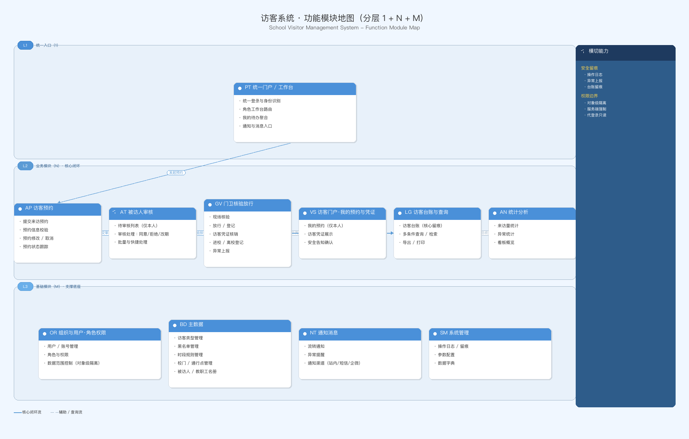

# 访客系统 · 功能模块地图（分层 1+N）+ 一句话需求定义

> 归属阶段：阶段一 · 需求规划（requirement-pipeline §「阶段一」第 2 个产出物）
> 用途：基于「名词统一文档」与已对齐的场景/痛点/角色/目标，画出**分层模块地图**（统一入口 1 + 业务模块 N + 基础模块 M），配**一句话需求定义**；作为阶段二版本规划（版本序列 + 边界骨架）的输入。
> 上游依赖：`01-名词统一.md`（角色、访客分类枚举、流程动词、状态口径）。
> 时间字段精确到秒（§3.12）。创建时刻：2026-10-10 18:32:00　最近修改：2026-10-12 09:40:00

---

## 〇、一句话需求定义

> **为中小学校园提供一套「访客预约 → 审核 → 核验 → 放行 → 离校 → 留痕」的闭环安全管控系统，让家长来访与外来人员进校的全流程「可预约、可核验、可追溯」，实现「保安全」目标。**

拆解：
- **为谁**：中小学校园的**管理员 / 门卫·保安 / 被访教职工 / 访客本人**四类角色。
- **解决什么**：来访**预约不规范、对接低效、安全管控弱、登记不全留痕难**四项痛点。
- **怎么做**：把来访全流程做成**一条可留痕的闭环**——预约（家长）／现场登记（外来人员）→ 审核 → 核验身份与凭证 → 放行进校 → 离校确认 → 全程台账留痕。
- **达成什么**：**保安全**——谁来过、什么时候、找谁、什么时候走，全都留痕可查，出事务可追溯。

---

## 一、分层结构总览（1 + N + M）

| 层 | 层名 | 模块 | 说明 |
|----|------|------|------|
| **1** | **统一入口** | 统一门户 / 工作台（PT） | 按登录角色进入不同工作台；统一登录、身份识别、待办聚合 |
| **N** | **业务模块** | 访客预约（AP）/ 被访人审核（AT）/ 门卫核验放行（GV）/ 访客门户·我的申请与凭证（VS，移动端）/ 访客台账与查询（LG）/ 统计分析（AN） | 承载「预约—审核—核验—放行—离校—留痕」核心闭环 |
| **M** | **基础模块** | 组织与用户·角色权限（OR）/ 主数据·访客类型·黑名单·时段规则·校门（BD）/ 通知消息（NT）/ 系统管理（SM） | 支撑业务模块的底座 |

> 域码对照（供后续 REQ-ID 使用，格式 `REQ-<域码>-NNN`，§3.2）：**PT** 平台门户 / **AP** 预约 / **AT** 审核 / **GV** 门卫核验放行 / **VS** 访客门户 / **LG** 台账 / **AN** 统计 / **BD** 基础数据 / **OR** 组织权限 / **NT** 通知 / **SM** 系统管理。

---

## 二、统一入口（1）——统一门户 / 工作台（PT）

| 功能点 | 说明 | 主要角色 |
|--------|------|---------|
| 统一登录与身份识别 | 账号/工号登录，识别角色与数据范围 | 全部 |
| 角色工作台路由 | 登录后按角色进入对应工作台（管理员台 / 门卫台 / 教职工台）；**访客本人无 web / 后台工作台**，不经后台路由，直接进入手机端访客端（VS） | 管理员 / 门卫 / 被访教职工 |
| 我的待办聚合 | 待审核预约、待核验、异常待处理集中展示 | 管理员 / 被访教职工 / 门卫 |
| 通知与消息入口 | 预约流转、审核结果、异常提醒的入口 | 全部 |
| 访客扫码申请入口 | 后台生成并展示/张贴「申请入口二维码」，访客扫码进入移动端访客端「我要申请」（§一「访客本人的入口形态」） | 管理员 / 门卫 |

---

## 三、业务模块（N）——核心闭环

### N1 访客预约（AP）· 域码 AP
| 功能点 | 说明 |
|--------|------|
| 提交来访预约 | 访客/被访人代提；填到访时段、事由、被访人、随行人数、车牌 |
| 预约信息校验 | 必填项、时段规则、黑名单预检（§3.23 枚举穷举、规则六要素） |
| **被访人邀约发起（G6）** | 被访教职工主动发起邀约、生成**邀请码 / 链接**发给访客；访客凭码快速提交或免填到访（与访客自助申请互补） |
| **常客快登（G8）** | 曾批准、无黑名单记录的访客再次到访可**一键复用**上次信息快速登记（仍须过黑名单与证件核验） |
| **随行人员逐人明细（G4）** | 预约时按**逐人**登记随行人员（姓名/关系/证件号），到访人数以明细条数为准 |
| 预约修改 / 取消 | 到访前可改期、可取消（状态流转见 01-名词统一 §4.2） |
| 预约状态跟踪 | 待审核 / 已通过 / 已拒绝 / 已改期 / 已过期等状态可视 |

### N2 被访人审核（AT）· 域码 AT
| 功能点 | 说明 |
|--------|------|
| 待审核列表 | 被访教职工仅见**本人**相关预约（§3.22 对象级隔离） |
| 审核处理 | 同意 / 拒绝 / 改期（审核人默认被访教职工，可配置） |
| **移动端审批（G7）** | 被访教职工在**手机 H5** 上查看待办并同意/拒绝/改期（消息推送直达），无需回电脑前处理 |
| 批量与快捷处理 | 常用场景快捷同意/拒绝（后续版本） |

### N3 门卫核验放行（GV）· 域码 GV
| 功能点 | 说明 |
|--------|------|
| 现场核验 | 核对身份信息 + 预约/凭证一致性、是否在有效时段 |
| **证件识别（G2）** | 读卡/拍照 OCR 识别访客证件，自动提取姓名、证件号并与预约比对（识别失败回退手工录入，可改留痕） |
| **现场人像采集（G3）** | 核验时对访客现场拍照留存，绑定本次来访记录（用于事后追溯，非人脸比对） |
| 放行 / 登记 | 记录放行时刻、放行人；无预约走现场登记 |
| 访客凭证核销 | 凭证（预约码/二维码/短码）核验核销 |
| **访客证 / 临时通行卡（G9）** | 核验通过后打印访客证（贴纸）或发放临时通行卡；离校回收/作废 |
| **车牌识别 · 道闸联动（G10）** | 识别访客车牌与登记车牌比对；有设备可联动道闸放行，无设备手工核对（可配 §3.25） |
| 进校 / 离校登记 | 记录到访时刻与离校时刻，形成「在校中」状态 |
| **批量核销（G5）** | 离校高峰/散场时可**多选批量**核销离校，避免逐条操作 |
| **超时催离（G5）** | 超过预定在校时长（或闭校时刻）未离校，向访客/门卫发**催离**提醒并置入待关注清单（阈值可配 §3.25） |
| 异常上报 | 黑名单命中、信息不符、超时未离校等异常上报留痕 |

### N4 访客门户 · 我的申请与凭证（VS，移动端 H5）· 域码 VS
> **形态**：访客本人使用**移动端访客端（手机 H5）**，**无任何 web / 后台端**（全部在手机端完成）。进入方式两种：① 到门口由门卫协助/现场登记；② **扫描「申请入口二维码」自助进入**。V1.0 仅承载以下**两个入口功能**：
| 功能点 | 说明 |
|--------|------|
| 我要申请 | 扫码/协助进入后，填写并提交本人来访预约（到访时段、事由、被访人、随行人数、车牌） |
| 我的申请（查看） | 访客本人查看**本人**预约状态与凭证（§3.22 仅本人）；页内出示通行凭证、阅读并确认安全告知 |

> 注：「访客凭证展示」「安全告知确认」在 **V1.0 并入「我的申请（查看）」页内**呈现，不单列入口。

### N5 访客台账与查询（LG）· 域码 LG
| 功能点 | 说明 |
|--------|------|
| 访客台账 | 全部来访记录汇总（谁、何时、找谁、何时走）——保安全核心留痕载体 |
| **在校（实时）清单（G1）** | 当前**仍在校园内**的访客实时名单（谁/何时进/找谁/已在校多久）——应急疏散与突发事件的安全核心视图 |
| 多条件查询 / 检索 | 按人、时段、事由、被访人、状态等检索 |
| 导出 / 打印 | 台账导出，供安全留档（口径同源 §3.24）；**支持按留存期限脱敏导出（G11）** |

### N6 统计分析（AN）· 域码 AN
| 功能点 | 说明 |
|--------|------|
| 来访量统计 | 按日/周/月、访客类型、班级/部门等维度统计 |
| 异常统计 | 异常类型分布、超时未离校等 |
| 看板概览 | 校领导/管理员安全概览（后续版本） |

---

## 四、基础模块（M）——支撑底座

### M1 组织与用户 · 角色权限（OR）· 域码 OR
| 功能点 | 说明 |
|--------|------|
| 用户 / 账号管理 | 管理员、门卫、教职工账号维护 |
| 角色与权限 | 角色 × 资源边界（§3.22 服务端强制三件套） |
| 数据范围控制 | 对象级隔离（被访人仅本人、访客仅本人） |

### M2 主数据（BD）· 域码 BD
| 功能点 | 说明 |
|--------|------|
| 访客类型管理 | 家长 / 外来人员 / 公务来访等枚举维护（跨周期增减用软状态 §3.21） |
| 黑名单管理 | 禁止进校人员名单，命中拦截 |
| **常客库管理（G8）** | 曾批准、无黑名单记录的访客档案库，支撑常客快登；支持按需清除常客身份 |
| 时段规则管理 | 可预约时段、有效时段缓冲、禁入时段（§3.25 可配项四件套）；含**在校时长上限 / 催离阈值（G5）** |
| 校门 / 通行点管理 | 多校门、通行点配置；含**车牌识别 / 道闸设备绑定开关（G10，可配）** |
| 被访人 / 教职工名册 | 被访对象主数据 |

### M3 通知消息（NT）· 域码 NT
| 功能点 | 说明 |
|--------|------|
| 流转通知 | 预约提交/审核结果/到访提醒；**被访人邀约通知（G6，含邀请码/链接）** |
| 异常提醒 | 超时未离校、黑名单命中提醒；**超时催离提醒（G5，推访客与被访人/门卫）** |
| 通知渠道 | 站内 / 短信 / 企微等（可配置，§3.25） |

### M4 系统管理（SM）· 域码 SM
| 功能点 | 说明 |
|--------|------|
| 操作日志 / 留痕 | 敏感操作（审核/放行/失败核验/代登录）写操作日志（§3.22） |
| **个人信息保护（G11）** | 访客个人信息（姓名/证件/车牌/人像）的**授权告知、最小必要收集、留存期限到期脱敏/清除**配置（期限可配 §3.25）；访客可索取/更正本人信息（对应 §3.22 对象级隔离） |
| 参数配置 | 系统参数、可配项（§3.25） |
| 数据字典 | 枚举与字典维护 |

---

## 五、模块 × 角色 可见性矩阵（初稿）

| 模块 | 管理员 | 门卫/保安 | 被访教职工 | 访客本人 |
|------|-------|----------|-----------|---------|
| PT 统一门户/工作台 | ✅ | ✅ | ✅ | —（**访客本人无 web 端**，不经后台） |
| AP 访客预约 | ✅（代提/维护） | — | ✅（代提） | —（提交入口在手机端 VS） |
| AT 被访人审核 | ✅（兜底） | — | ✅（仅本人，**含手机端 G7**） | — |
| GV 门卫核验放行 | ✅（监控） | ✅ | — | — |
| VS 访客门户（移动端） | — | ✅（协助/登记） | — | ✅（仅本人 · 手机 H5，无 web 端） |
| LG 访客台账 | ✅（全校） | ✅（当日/现场） | — | —（本人记录经手机端 VS 查看） |
| AN 统计分析 | ✅ | — | — | — |
| OR 组织权限 | ✅ | — | — | — |
| BD 主数据 | ✅ | — | — | — |
| NT 通知 | ✅ | ✅ | ✅ | ✅ |
| SM 系统管理 | ✅ | — | — | — |

> ⚠️ 上表为**初稿**，数据范围与权限边界将在阶段三按 §3.22「服务端强制三件套」逐条闭合（具体路由/接口 + 越权 403 + 审计留痕 + adminOnly 清单）。

---

## 六、待确认问题（Q，带入阶段二）

| 编号 | 问题 | 初步建议 |
|------|------|---------|
| Q1 | 访客凭证形态（预约编号+二维码？短码？闸机核销？） | 建议 V1.0 先用「预约编号 + 二维码」，闸机接入留后续版本 |
| Q2 | ~~是否上线访客自助端还是仅现场登记~~ | **已确认（用户反馈 2026-10-10）**：V1.0 提供**移动端访客端（手机 H5）**，仅含「我要申请」「我的申请（查看）」；访客可**扫「申请入口二维码」自助申请**，外来人员也可现场登记 |
| Q3 | 审核人默认是谁（被访教职工？管理员？） | 建议默认被访教职工，可配置 |
| Q4 | 黑名单是全校统一还是分场景 | 建议 V1.0 全校统一 |
| Q5 | 通知渠道优先级（站内/短信/企微） | 建议 V1.0 站内为主，短信/企微后续版本 |
| Q6 | 现场设备具备情况（证件读卡器 / 摄像头人像 / 车牌识别·道闸）——决定 G2/G3/G10 走**自动识别**还是**手工录入** | 建议 V1.0：证件识别、人像采集走**拍照+手工可改**（不依赖读卡器）；车牌识别·道闸做**开关预留**，有设备再启用 |
| Q7 | 访客个人信息**留存期限**默认多久、到期如何处理 | 建议 V1.0 默认留存 90 天（可配），到期**自动脱敏**（保留统计、隐去证件号/人像），支持人工清除（G11） |

> 以上 Q 为**方向性待确认**，具体取值随阶段三需求清单按 §3.23 闭合。

---

## 七、与可视化架构图的关系

本文件为**文字版模块地图**；配套**可视化架构图**（PNG/SVG/HTML 三格式）已由 `business-architecture-diagram` 生成，文件见 `assets/访客系统-功能模块地图.{png,svg,html}` 与本目录 `02-功能模块地图-架构图.png`。架构图内容与本章分层结构**逐字一致**。

> 生成配置：`assets/访客系统-功能模块地图.json`（分层 1 统一入口 + N6 业务模块 + M4 基础模块，含核心闭环实线流、辅助查询虚线流、右侧横切能力栏）。HTML 版可在浏览器打开，支持缩放 / 拖动 / 滚动查看。
